<div class="portada">
<div class="portada-logo"><svg viewBox="0 0 44 44" width="88" height="88" aria-hidden="true"><rect width="44" height="44" rx="13" fill="#0E7A55"/><path d="M18.6 10.5h6.8v8.1h8.1v6.8h-8.1v8.1h-6.8v-8.1h-8.1v-6.8h8.1z" fill="#FFFFFF"/><path d="M31.5 7.5c-4.2.3-6.6 2.8-6.9 6.9 4.1-.2 6.6-2.7 6.9-6.9z" fill="#A6E0C4"/></svg></div>
<p class="portada-universidad">UNIVERSIDAD TECNOLÓGICA DEL PERÚ</p>
<p class="portada-escuela">Escuela Profesional de Ingeniería de Sistemas e Información</p>
<p class="portada-curso">Curso: Servicios Cloud</p>
<p class="portada-titulo">DISEÑO E IMPLEMENTACIÓN DE UNA PLATAFORMA E-COMMERCE FARMACÉUTICA UTILIZANDO CONTENEDORES, INFRAESTRUCTURA COMO CÓDIGO Y SERVICIOS CLOUD</p>
<p class="portada-proyecto">Kay Care Farmacia</p>
<table class="portada-datos">
<tr><td>Estudiante</td><td>Elias Paz Benavides</td></tr>
<tr><td>Docente</td><td>[Pendiente]</td></tr>
<tr><td>Ciclo</td><td>[Pendiente]</td></tr>
<tr><td>Fecha</td><td>Noviembre de 2026</td></tr>
</table>
<p class="portada-aviso">PROYECTO ACADÉMICO — TIENDA DEMOSTRATIVA — NO SE REALIZAN VENTAS REALES</p>
</div>

<div class="toc-placeholder"></div>

## 1. Resumen ejecutivo

**Kay Care Farmacia** es una plataforma de comercio electrónico farmacéutico de carácter académico. Ofrece un catálogo de productos ficticios de venta libre y de cuidado personal, un carrito de compras, un checkout simulado y un panel de administración. No vende, no cobra y no solicita datos personales reales.

**Problemática.** Las farmacias tradicionales y los pequeños negocios del sector pueden tener dificultades para abrir un canal digital: el costo de la infraestructura, la complejidad técnica, la gestión del inventario y la necesidad de mantener la plataforma disponible y segura. El proyecto aborda ese escenario general como caso de estudio.

**Solución.** Se desarrolló una aplicación web en tres capas: interfaz en **Vue 3**, API REST en **Laravel 12** y base de datos **PostgreSQL 16**, empaquetadas en contenedores **Docker** y orquestadas localmente con **Docker Compose**. La infraestructura en la nube de **Microsoft Azure** está descrita como código con **Terraform** en dos entornos: DEMO, de costo mínimo, y HA, de alta disponibilidad. La integración continua se automatizó con **GitHub Actions**. La compra protege el inventario con una transacción con bloqueo de filas, precios calculados en el servidor y una clave de idempotencia.

**Relación con Cloud Computing.** El proyecto aplica los pilares del curso:
- infraestructura como código;
- contenedores;
- automatización CI/CD;
- seguridad por capas;
- un diseño de alta disponibilidad basado en réplicas, zonas de disponibilidad y base de datos redundante.

**Resultados comprobables (12 de noviembre de 2026):**
- 70 pruebas automatizadas del backend sobre PostgreSQL;
- 45 pruebas del frontend;
- 3 recorridos completos en navegador contra los contenedores reales, sin errores de accesibilidad;
- una prueba de compras simultáneas sin sobreventa;
- una prueba local de tolerancia a fallos: 179 de 180 solicitudes atendidas con una réplica caída;
- la validación de Terraform en ambos entornos;
- la CI de GitHub en verde.

La infraestructura de Azure **está preparada, pero no desplegada**: el despliegue se reserva para el día de la exposición, y por eso todavía no existe una URL pública.

**Abstract.** *Kay Care Farmacia* is an academic pharmacy e-commerce platform with fictitious over-the-counter products, a shopping cart, a simulated checkout and an administration panel. It is built as a three-tier web application (Vue 3, Laravel 12 and PostgreSQL 16) packaged in Docker containers and orchestrated locally with Docker Compose. Its Microsoft Azure infrastructure is defined as code with Terraform for a minimum-cost DEMO environment and a zone-redundant HA environment, and continuous integration runs on GitHub Actions. Checkout protects inventory through a database transaction with row-level locks, server-side pricing and idempotency keys. Seventy backend tests, forty-five frontend tests, three end-to-end browser runs, a concurrency test, a local fault-tolerance test and Terraform validation were executed successfully. The Azure infrastructure is prepared but not yet deployed; deployment is reserved for the presentation day, so no public URL exists yet.

## 2. Introducción

La transformación digital ha llevado a muchos comercios a complementar su atención presencial con canales en línea. En el sector farmacéutico, un canal digital permite mostrar el catálogo, informar la disponibilidad de productos y recibir pedidos sin depender del horario de atención física.

Una tienda en línea, sin embargo, plantea exigencias técnicas que no aparecen en una página web informativa:

- **Disponibilidad:** si la tienda deja de responder, el cliente no puede comprar y el negocio pierde la venta.
- **Escalabilidad:** el tráfico no es constante; campañas y temporadas pueden multiplicar las visitas.
- **Seguridad:** la plataforma maneja sesiones, credenciales administrativas e información comercial que deben protegerse.
- **Automatización:** cada actualización de la aplicación debería probarse y publicarse de forma repetible, sin pasos manuales propensos a error.
- **Integridad del inventario:** dos clientes no deberían poder comprar la última unidad de un producto al mismo tiempo.
- **Infraestructura confiable:** servidores, redes y bases de datos deben configurarse de forma reproducible y documentada.

Los **servicios cloud** responden a estas necesidades con recursos bajo demanda (computación, bases de datos gestionadas, redes y balanceo de carga), pago por uso y mecanismos de redundancia ofrecidos por el proveedor. Este proyecto utiliza Kay Care Farmacia como caso práctico para aplicar esos conceptos de extremo a extremo.

## 3. Problemática

Este apartado plantea un **escenario académico** construido a partir de desafíos generales del sector. Kay Care Farmacia **no es una empresa real**, y este informe no se basa en encuestas, entrevistas ni estadísticas propias.

Una farmacia tradicional o un pequeño negocio del rubro que quiera vender por internet suele enfrentar estas dificultades:

1. **Costo de infraestructura.** Comprar y mantener servidores propios exige una inversión inicial y personal técnico.
2. **Complejidad técnica.** Una tienda en línea necesita frontend, backend, base de datos, seguridad y despliegue: muchas piezas que deben integrarse correctamente.
3. **Gestión de inventario.** Si el stock se controla manualmente o en sistemas aislados, la información publicada puede no coincidir con la existencia real.
4. **Disponibilidad y seguridad.** Un único servidor representa un punto único de fallo; sin controles adecuados, la plataforma queda expuesta a ataques comunes.

Estas dificultades generan consecuencias concretas:

| Consecuencia | Efecto en el negocio |
|---|---|
| Limitaciones para mostrar productos por internet | El cliente no conoce el catálogo ni la disponibilidad sin acudir al local. |
| Procesos manuales de inventario | Errores de stock, sobreventa o productos publicados que ya no existen. |
| Dificultad para escalar | En momentos de alta demanda, el sistema se vuelve lento o deja de responder. |
| Riesgo de interrupción del servicio | Una falla del servidor detiene por completo las ventas en línea. |
| Complejidad para actualizar la aplicación | Cada cambio implica riesgo y tiempo de inactividad. |
| Costos de mantenimiento | Hardware, licencias y personal permanentes, aunque el tráfico sea bajo. |
| Falta de automatización de despliegues | Publicaciones manuales, difíciles de repetir y de auditar. |

El proyecto propone una arquitectura cloud que reduce estas barreras: la aplicación se empaqueta en contenedores reproducibles, la infraestructura se define como código, las pruebas y validaciones se automatizan, el inventario se protege con transacciones, y se diseña una variante de alta disponibilidad para cuando el negocio la requiera.

## 4. Formulación del problema

**Pregunta central.** ¿Cómo implementar una plataforma de comercio electrónico farmacéutico mediante servicios cloud, contenedores e infraestructura como código, garantizando seguridad, escalabilidad y una arquitectura preparada para alta disponibilidad?

**Preguntas específicas:**

1. ¿Cómo empaquetar la aplicación con **Docker** para que funcione igual en el equipo de desarrollo y en la nube?
2. ¿Cómo describir la infraestructura de Azure con **Terraform** para crearla de forma repetible y revisable, sin configuraciones manuales?
3. ¿Cómo automatizar pruebas, validaciones y construcción de imágenes con **CI/CD** sin que un cambio pueda desplegar recursos facturables por accidente?
4. ¿Qué **controles de seguridad** son necesarios para proteger sesiones, datos y la base de datos de una tienda en línea?
5. ¿Cómo evitar que el sistema **venda productos sin stock** cuando varios clientes compran al mismo tiempo?

## 5. Justificación

- **Tecnológica.** El proyecto integra en un caso real las tecnologías usadas en la industria: contenedores, infraestructura como código, CI/CD, bases de datos transaccionales y servicios PaaS de Azure. Permite demostrar cada competencia con código ejecutable.
- **Económica.** El modelo de pago por uso de la nube evita la compra de servidores. El entorno DEMO escala a cero cuando no hay tráfico, y su costo estimado para un día de exposición es de alrededor de US$ 0,60 si se retira el mismo día (sección 22). El desarrollo local con Docker no tiene costo de nube.
- **Académica.** Cubre las indicaciones del curso Servicios Cloud: código IaC, contenedores, automatización, seguridad y alta disponibilidad aplicados a una plataforma e-commerce visible en la web.
- **Operativa.** Docker Compose levanta el sistema completo con un solo comando. Terraform permite crear y retirar la infraestructura de forma controlada. Las pruebas automatizadas detectan errores antes de integrar cambios.

## 6. Objetivos

**Objetivo general.** Diseñar e implementar una plataforma de comercio electrónico farmacéutico académica, contenerizada y preparada para Azure mediante infraestructura como código, con automatización, seguridad y un diseño de alta disponibilidad.

**Objetivos específicos:**

1. Desarrollar una tienda web con catálogo, búsqueda, filtros, carrito, checkout simulado y panel de administración conectados a una API y una base de datos reales.
2. Garantizar la integridad del inventario mediante transacciones con bloqueo de filas y claves de idempotencia, verificándolo con pruebas de concurrencia.
3. Contenerizar frontend, backend y base de datos con Docker y orquestarlos con Docker Compose, con health checks y persistencia.
4. Definir con Terraform la infraestructura de Azure en dos entornos (DEMO y HA) y validarla sin consumir créditos antes de la exposición.
5. Automatizar pruebas, validaciones y construcción de imágenes con GitHub Actions, con un despliegue exclusivamente manual y autorizado.
6. Documentar y probar los controles de seguridad y el diseño de alta disponibilidad, distinguiendo lo diseñado de lo probado.

## 7. Alcance

**El proyecto incluye:**

| Elemento | Detalle |
|---|---|
| Catálogo web | 24 productos ficticios de venta libre y cuidado personal |
| Categorías | Medicamentos de venta libre, Vitaminas y bienestar, Cuidado personal, Higiene, Primeros auxilios, Cuidado infantil |
| Búsqueda | Por nombre, marca o SKU, con sugerencias en vivo |
| Carrito | Panel lateral con cantidades, subtotal y validación de stock contra el servidor |
| Checkout simulado | Solo un alias ficticio; sin pagos, sin DNI y sin dirección |
| Gestión administrativa | Login, dashboard, productos, stock auditado y pedidos por estados |
| Base de datos | PostgreSQL 16 con restricciones de integridad |
| Contenedores | Imágenes Docker sin privilegios de root y Docker Compose |
| Infraestructura IaC | Terraform para Azure: entornos DEMO y HA |
| Automatización | GitHub Actions: CI automática y CD solo manual |
| Seguridad | Validación, autenticación, CSRF, CSP, rate limiting, secretos fuera de Git |
| Alta disponibilidad | Diseño HA en Terraform y prueba local de tolerancia a fallos |

**El proyecto no incluye:**
- ventas reales ni transacciones bancarias;
- envíos;
- comercialización de medicamentos verdaderos (todos los productos y marcas son ficticios, de venta libre y sin indicaciones médicas);
- uso de datos de pacientes ni de personas reales.

Kay Care Farmacia es independiente del sistema clínico **Kay Care Enfermería**, que comparte repositorio pero no base de datos, sesiones ni credenciales, y que **no fue modificado**.

## 8. Requerimientos

**Tabla 1.** Requerimientos funcionales y su implementación.

| ID | Requerimiento | Implementación real |
|---|---|---|
| RF-01 | Página de inicio con categorías, ofertas y destacados | `frontend/src/views/HomeView.vue` |
| RF-02 | Catálogo con búsqueda, filtros, orden y paginación | `CatalogView.vue` · `GET /api/v1/store/products` |
| RF-03 | Buscador con sugerencias en vivo | `components/SearchBox.vue` |
| RF-04 | Detalle de producto con stock y relacionados | `ProductView.vue` · `GET /products/{slug}` |
| RF-05 | Carrito con validación de stock en el servidor | `CartDrawer.vue`, `stores/cart.ts` · `POST /cart/validate` |
| RF-06 | Checkout simulado con alias ficticio | `CheckoutView.vue` · `POST /checkout` |
| RF-07 | Confirmación con número de pedido | `ConfirmationView.vue` · `GET /orders/{número}` |
| RF-08 | Login administrativo sin registro público | `AdminLoginView.vue` · `POST /admin/login` |
| RF-09 | Gestión de productos, ofertas y stock auditado | `AdminProductsView.vue`, `AdminStockView.vue` |
| RF-10 | Gestión de pedidos por estados | `AdminOrdersView.vue` · `PATCH /admin/orders/{id}/status` |
| RF-11 | Aviso académico visible | `DemoBanner.vue` y pie de página |

**Tabla 2.** Requerimientos no funcionales y su implementación.

| ID | Requerimiento | Implementación real |
|---|---|---|
| RNF-01 | Integridad del inventario | Transacción con `SELECT … FOR UPDATE`, `CHECK stock >= 0`, idempotencia |
| RNF-02 | Seguridad | CSRF (Sanctum), CSP, bcrypt, rate limiting, contenedores sin root |
| RNF-03 | Portabilidad | `docker compose up --build` levanta todo el sistema |
| RNF-04 | Reproducibilidad de la infraestructura | Terraform en `infra/terraform/` |
| RNF-05 | Automatización | `.github/workflows/pharmacy-ci.yml` |
| RNF-06 | Disponibilidad | Health checks, réplicas y diseño HA (`environments/ha`) |
| RNF-07 | Accesibilidad | axe-core sin violaciones en las páginas auditadas |
| RNF-08 | Control de costos | DEMO con escala a cero; despliegue solo con confirmación |

## 9. Marco teórico

**Cloud Computing.** Modelo que permite acceder por red y bajo demanda a un conjunto compartido de recursos configurables (servidores, almacenamiento, aplicaciones) que se aprovisionan y liberan rápidamente con mínima gestión (Mell y Grance, 2011). En Kay Care, en lugar de comprar un servidor, se usarían Azure Container Apps y PostgreSQL gestionado.

**IaaS, PaaS y SaaS.**
- **IaaS** (infraestructura como servicio): el proveedor entrega máquinas virtuales y redes, y el cliente administra el sistema operativo.
- **PaaS** (plataforma como servicio): el proveedor administra además el sistema operativo y el entorno de ejecución.
- **SaaS** (software como servicio): se consume una aplicación terminada.

Kay Care usa servicios **PaaS**: Azure Container Apps ejecuta los contenedores sin administrar servidores, y Azure Database for PostgreSQL es una base de datos gestionada.

**Contenedores y Docker.** Un contenedor empaqueta una aplicación con sus dependencias y se ejecuta aislado sobre el núcleo del sistema anfitrión. Una **imagen** es la plantilla inmutable; un **contenedor** es una instancia en ejecución de esa imagen. Docker es la herramienta que construye imágenes (a partir de un `Dockerfile`) y ejecuta contenedores. En Kay Care hay una imagen para la API y otra para el frontend.

**Docker Compose.** Define en un archivo YAML varios servicios que trabajan juntos (redes, volúmenes, variables) y los levanta con un solo comando. Kay Care define tres servicios: `db`, `backend` y `frontend`.

**Infrastructure as Code y Terraform.** La infraestructura como código describe servidores, redes y bases de datos en archivos de texto versionados, en lugar de configurarlos a mano en un portal (Morris, 2020). Terraform es una herramienta declarativa: se describe el estado deseado y Terraform calcula qué crear, modificar o eliminar. Kay Care define en Terraform el grupo de recursos, Container Apps, PostgreSQL y Log Analytics.

**CI/CD y GitHub Actions.**
- La **integración continua (CI)** compila y prueba automáticamente cada cambio.
- La **entrega o despliegue continuo (CD)** publica la versión validada en un entorno (Humble y Farley, 2010).

GitHub Actions ejecuta estos procesos en servidores de GitHub cuando ocurre un evento, como un *push* o un *pull request*.

**Escalabilidad horizontal.** Aumentar la capacidad agregando más instancias (réplicas) de un servicio, en lugar de una máquina más potente (escalabilidad vertical). En Azure Container Apps, la API puede pasar de 0 a N réplicas según las solicitudes.

**Alta disponibilidad y balanceo de carga.** La alta disponibilidad busca que el servicio siga funcionando aunque falle un componente, eliminando puntos únicos de fallo mediante redundancia (Beyer et al., 2016). Un **balanceador de carga** reparte las solicitudes entre varias réplicas y deja de enviar tráfico a las que no responden.

**Health checks.** Comprobaciones periódicas que indican si un servicio está vivo y listo para recibir tráfico. Kay Care expone `GET /api/v1/store/health` (verifica también la base de datos) y `GET /healthz` en el frontend.

**Seguridad cloud.** Responsabilidad compartida: el proveedor protege la infraestructura física y la plataforma, y el cliente protege su aplicación, sus datos, sus credenciales y su configuración. En Kay Care se aplican controles en cada capa (sección 18).

**Bases de datos relacionales.** Organizan los datos en tablas relacionadas mediante claves y garantizan transacciones **ACID** (atómicas, consistentes, aisladas y durables). PostgreSQL permite además bloquear filas durante una transacción (PostgreSQL Global Development Group, 2026).

**Arquitectura cliente-servidor.** El cliente (navegador con Vue) solicita información y el servidor (API Laravel) la procesa y responde en formato JSON. El cliente nunca accede directamente a la base de datos.

## 10. Arquitectura del sistema

El usuario interactúa con el navegador, que descarga la aplicación Vue desde nginx. Cuando la aplicación necesita datos, llama a `/api/...` en el **mismo origen**; nginx reenvía esas solicitudes a la API Laravel, que aplica las reglas de negocio y consulta PostgreSQL.

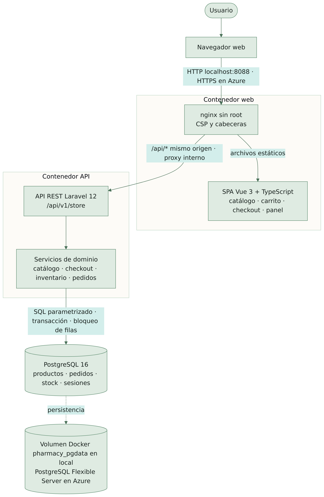

**Tabla 3.** Componentes de la arquitectura.

| Componente | Qué hace | Por qué lo necesitamos |
|---|---|---|
| Navegador | Muestra la tienda y ejecuta la aplicación Vue | Es la puerta de entrada del cliente |
| nginx (contenedor web) | Sirve los archivos de Vue, agrega cabeceras de seguridad y reenvía `/api` | Un solo origen simplifica la seguridad (cookies, CSRF, CORS) y oculta la API |
| Vue 3 (SPA) | Interfaz: catálogo, carrito, checkout y panel | Experiencia fluida sin recargar páginas |
| API Laravel (contenedor) | Valida datos, calcula precios, controla stock y registra pedidos | Las reglas de negocio no pueden quedar en el navegador |
| PostgreSQL | Guarda productos, pedidos, movimientos y sesiones | Transacciones y restricciones garantizan la integridad |

En Azure (diagrama B, sección 20), el contenedor web se publica con HTTPS en Azure Container Apps y la API solo tiene acceso interno.

## 11. Tecnologías utilizadas

**Tabla 4.** Tecnologías efectivamente utilizadas.

| Tecnología | Función | Justificación de elección |
|---|---|---|
| Vue 3 + TypeScript | Interfaz de la tienda y del panel | Componentes reutilizables y tipado que reduce errores |
| Vite | Compilación del frontend | Compilación rápida y optimizada para producción |
| Tailwind CSS | Estilos | Diseño consistente y responsive con clases utilitarias |
| Vue Router · Pinia | Navegación y estado (carrito, sesión) | Herramientas oficiales del ecosistema Vue |
| Lucide | Iconos | Iconos libres y livianos, sin marcas de terceros |
| Laravel 12 (PHP 8.3) | API REST | Validación, autenticación y ORM maduros |
| Laravel Sanctum | Sesión del administrador y CSRF | Autenticación por cookie segura para SPA |
| FrankenPHP | Servidor de la API en el contenedor | Servidor PHP moderno que se ejecuta sin root |
| PostgreSQL 16 | Base de datos | Transacciones ACID, bloqueo de filas y restricciones `CHECK` |
| nginx (unprivileged) | Servidor web y proxy | Liviano, con cabeceras de seguridad y sin root |
| Docker y Docker Compose | Contenedores y orquestación local | Ejecución idéntica en cualquier equipo |
| Terraform (azurerm) | Infraestructura de Azure como código | Declarativo, versionable y multiplataforma |
| Microsoft Azure | Plataforma cloud prevista | Container Apps y PostgreSQL gestionado; disponibilidad de Azure for Students |
| GitHub Actions | CI/CD | Integrado con el repositorio y con OIDC hacia Azure |
| GHCR | Registro de imágenes | Sin costo para paquetes públicos e integrado con Actions |
| PHPUnit · Vitest · Playwright · axe-core | Pruebas | Unitarias, de componentes, de extremo a extremo y de accesibilidad |

## 12. Funcionamiento de la aplicación

**Tabla 5.** Recorrido de compra y su relación con el código.

| Paso | Qué ocurre | Código / endpoint |
|---|---|---|
| 1. El usuario entra a la farmacia | Se cargan las categorías, las ofertas y los destacados | `HomeView.vue` · `GET /categories`, `GET /products?featured=1`, `GET /products?on_sale=1` |
| 2. Explora productos | Navega por el catálogo paginado | `CatalogView.vue` · `GET /products?page=` |
| 3. Busca o filtra | Escribe en el buscador o usa filtros de categoría, precio, stock y ofertas | `SearchBox.vue` · `GET /products?q=&category=&min_price=&on_sale=` |
| 4. Selecciona un producto | Ve precio, stock, descripción y productos relacionados | `ProductView.vue` · `GET /products/{slug}` |
| 5. Añade al carrito | El carrito limita a 10 unidades por producto y al stock visible | `stores/cart.ts` (`MAX_QUANTITY = 10`) |
| 6. Revisa cantidades | El servidor recalcula precios y verifica stock | `CartDrawer.vue` · `POST /cart/validate` |
| 7. Compra simulada | Ingresa un alias ficticio y acepta el aviso | `CheckoutView.vue` · `POST /checkout` con `Idempotency-Key` |
| 8. Laravel valida el inventario | Bloquea las filas de los productos y verifica el stock | `CheckoutService::createOrder()` con `lockForUpdate()` |
| 9. PostgreSQL registra el pedido | Inserta el pedido y sus líneas, descuenta el stock y audita el movimiento | Tablas `orders`, `order_items`, `stock_movements` |
| 10. Se muestra la confirmación | «Pedido realizado en entorno de demostración» | `ConfirmationView.vue` · `GET /orders/{número}?token=` |

## 13. Diagrama de flujo

El diagrama muestra el proceso de compra con sus decisiones y excepciones:
- producto disponible o agotado;
- cantidad válida o inválida;
- stock suficiente o insuficiente;
- errores de validación;
- límite de intentos;
- error de servidor;
- compra confirmada.

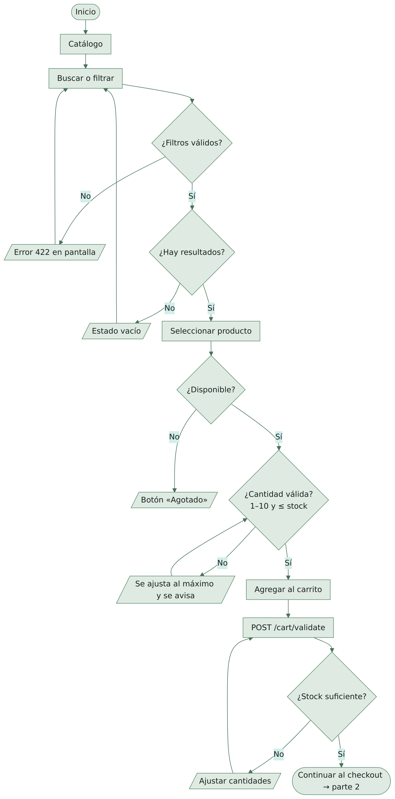

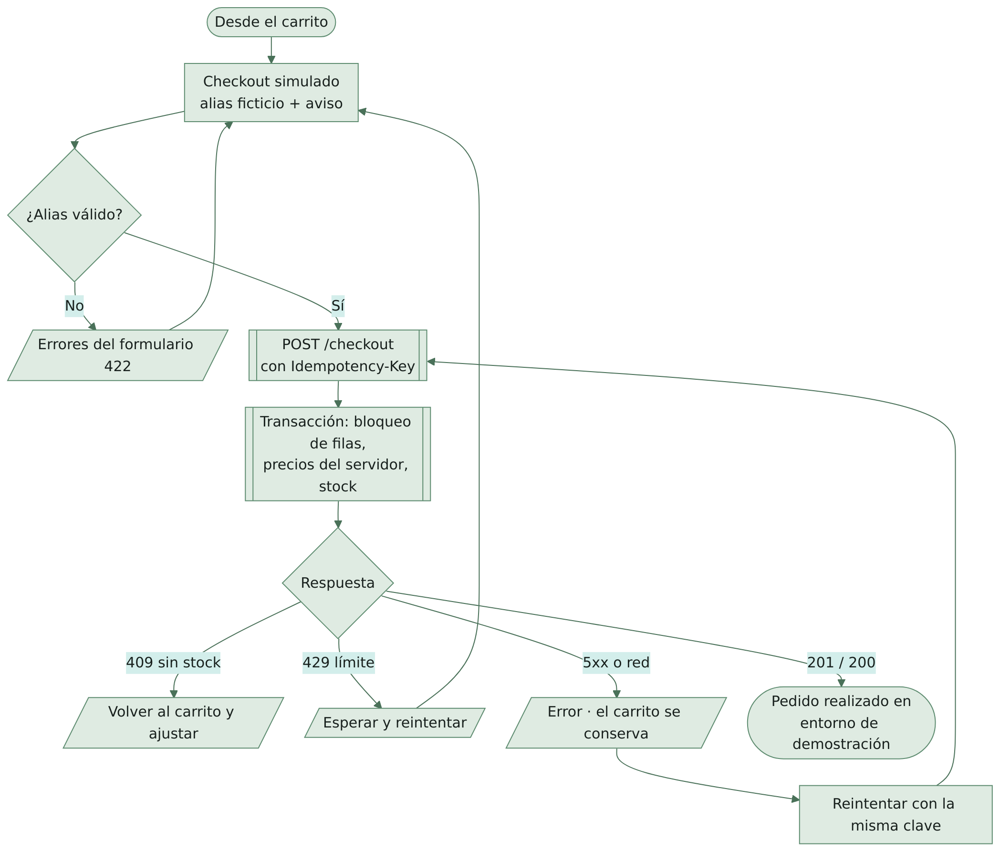

Las dos partes corresponden al diagrama completo `docs/diagrams/export/a-flujo-compra.png`, que se divide aquí para que sea legible en formato A4.

Ante un error de servidor o un fallo de red, el carrito se conserva y el reintento usa **la misma clave de idempotencia**. Si el primer intento llegó a registrarse, el servidor devuelve el mismo pedido en lugar de crear uno duplicado.

## 14. Base de datos

La base de datos de la farmacia es exclusiva del proyecto: no comparte tablas ni credenciales con el sistema clínico.

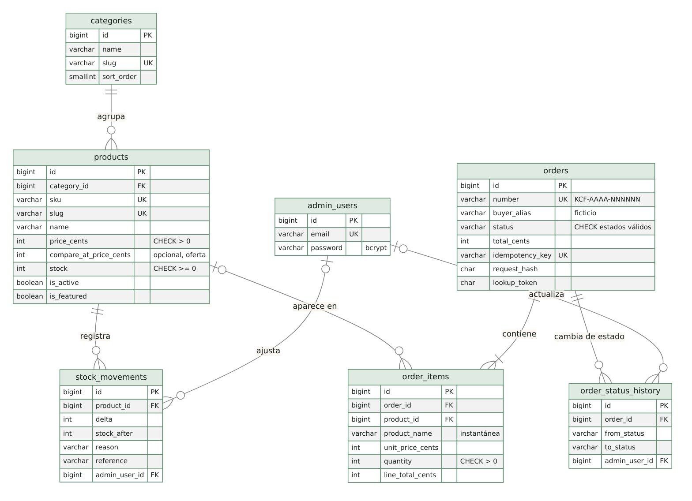

**Tabla 6.** Tablas principales.

| Tabla | Propósito | Restricciones relevantes |
|---|---|---|
| `categories` | Categorías del catálogo | `slug` único |
| `products` | Productos ficticios | SKU y slug únicos; `CHECK (stock >= 0)`; `CHECK (price_cents > 0)`; precios en céntimos; `compare_at_price_cents` opcional para ofertas |
| `orders` | Pedidos simulados | número único; `idempotency_key` **única**; `request_hash`; `lookup_token`; `CHECK` de estados válidos |
| `order_items` | Líneas del pedido con instantánea del nombre, SKU y precio | `CHECK (quantity > 0)` |
| `stock_movements` | Auditoría de cada cambio de inventario | delta, stock resultante, motivo, referencia |
| `order_status_history` | Historial de estados del pedido | estado anterior, nuevo estado, administrador |
| `admin_users` | Única identidad que inicia sesión | email único, contraseña con bcrypt |
| `sessions`, `cache`, `cache_locks`, `jobs` | Infraestructura de Laravel | — |

**Relaciones.**
- Una categoría agrupa muchos productos.
- Un pedido contiene una o más líneas.
- Un producto acumula movimientos de stock.
- Un pedido registra su historial de estados.

Las líneas guardan una **copia** del nombre y del precio, de modo que el pedido no cambia si después se edita el producto.

**Cómo se evitan pedidos inconsistentes:**
1. **Transacción única:** el pedido, sus líneas, el descuento de stock y los movimientos se graban juntos o no se graba nada.
2. **Bloqueo de filas:** `SELECT … FOR UPDATE` en orden ascendente de id, para evitar interbloqueos, impide que dos compras descuenten la misma unidad.
3. **Restricciones de la base de datos:** aunque hubiera un error en el código, PostgreSQL rechaza un stock negativo o una cantidad igual a cero.
4. **Idempotencia:** la clave única impide registrar dos veces el mismo pedido ante reintentos.

Fragmento real del servicio de checkout (`backend/app/Services/Checkout/CheckoutService.php`):

```php
$products = Product::query()
    ->whereIn('id', array_keys($normalized))
    ->orderBy('id')
    ->lockForUpdate()   // bloquea las filas hasta el COMMIT
    ->get()
    ->keyBy('id');
```

Los importes se guardan como enteros en céntimos de sol, lo que evita errores de redondeo. El IGV del 18 % está incluido en el precio y se desglosa como `round(total × 18 / 118)`.

## 15. Contenerización con Docker

**Imagen y contenedor.** La imagen es la «receta empaquetada»: sistema base, dependencias y código, construida a partir de un `Dockerfile`. El contenedor es esa imagen **en ejecución**. De una misma imagen pueden salir varios contenedores, por ejemplo varias réplicas de la API.

**Cómo se usa Docker en Kay Care:**
- `backend/Dockerfile`: construcción en varias etapas (Composer → FrankenPHP con PHP 8.3). Se ejecuta con el usuario `app` (UID 10001), sin root.
- `frontend/Dockerfile`: compila Vue con Node 20 y sirve el resultado con `nginx-unprivileged` (UID 101).

**Servicios de Docker Compose** (`academic-pharmacy/docker-compose.yml`):

| Servicio | Imagen | Función | Health check |
|---|---|---|---|
| `db` | `postgres:16-alpine` | Base de datos | `pg_isready` |
| `backend` | `kaycare-pharmacy-backend:local` | API Laravel | `GET /api/v1/store/health` |
| `frontend` | `kaycare-pharmacy-frontend:local` | nginx + Vue, puerto 8088 | `GET /healthz` |

**Comunicación y aislamiento:**
- El navegador solo llega al frontend (puerto 8088).
- El frontend reenvía `/api` al backend por la red `web`.
- El backend llega a PostgreSQL por la red `data`, que está declarada como **interna**: la base de datos no tiene puerto publicado ni salida a internet.
- Los contenedores corren con sistema de archivos de solo lectura, sin capacidades (`cap_drop: ALL`) y con `no-new-privileges`.

```yaml
networks:
  # Red interna: PostgreSQL no tiene salida ni puerto publicado.
  data:
    internal: true
```

**Persistencia.** PostgreSQL guarda sus datos en el volumen `kaycare-pharmacy_pharmacy_pgdata`. Se comprobó que, al reconstruir los contenedores, los 25 pedidos existentes se conservaron.

**Comandos para ejecutar el proyecto:**

```bash
cd academic-pharmacy
cp .env.example .env          # opcional: contraseñas propias
docker compose up --build     # tienda en http://localhost:8088
docker compose ps             # estado y salud de los servicios
docker compose down           # detener (los datos se conservan)
```

**Beneficios.** El sistema funciona igual en cualquier equipo con Docker. Las mismas imágenes, construidas por la CI, son las que usaría Azure. Además, el aislamiento entre servicios reduce la superficie de ataque.

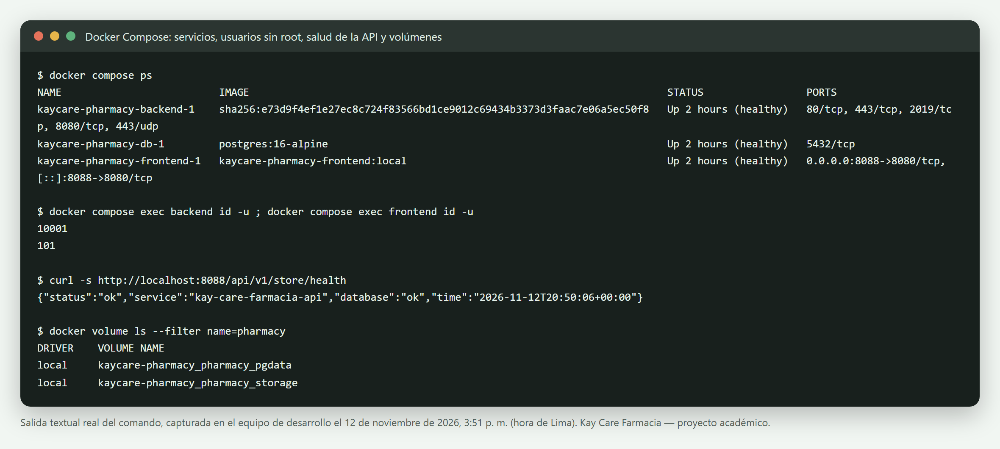

## 16. Infraestructura como código (Terraform)

**Conceptos aplicados al proyecto:**

| Concepto | Qué es | En Kay Care |
|---|---|---|
| Provider | Plugin que permite hablar con una nube | `azurerm` (Azure) y `random` (contraseñas) |
| Resource | Recurso que Terraform crea | `azurerm_container_app`, `azurerm_postgresql_flexible_server`… |
| Variable | Parámetro configurable | `location`, `backend_image`, `max_replicas`… |
| Output | Valor que se muestra al terminar | `frontend_url`, `postgres_fqdn` |
| State | Registro de lo que Terraform creó | `terraform.tfstate` (local, ignorado por Git) |
| Módulo | Grupo reutilizable de recursos | `monitoring`, `network`, `postgres`, `container-environment`, `container-app` |

**Comandos:**
- `terraform init` descarga los providers;
- `terraform validate` comprueba la sintaxis y la coherencia;
- `terraform plan` muestra qué se crearía, sin crear nada;
- `terraform apply` crea los recursos.

En este proyecto se ejecutaron `fmt`, `init -backend=false` y `validate`. **`plan` contra la suscripción, `apply` y `destroy` no se han ejecutado**, porque el despliegue está reservado para el día de la exposición.

**Estructura:**

```
infra/terraform/
├── modules/      monitoring · network · postgres · container-environment · container-app
└── environments/
    ├── demo/     versions.tf providers.tf variables.tf main.tf outputs.tf terraform.tfvars.example
    └── ha/       (misma estructura)
```

**Recursos de Azure definidos:**

| Recurso Terraform | DEMO | HA |
|---|---|---|
| `azurerm_resource_group` (`rg-kcf-<entorno>`) | Sí | Sí |
| `azurerm_log_analytics_workspace` | Sí (tope 0,1 GB/día) | Sí (90 días) |
| `azurerm_container_app_environment` | Sí, sin VNet | Sí, con redundancia de zona |
| `azurerm_container_app` × 2 (web y API) | 0–1 réplica, 0,25 vCPU | Web 2–6 y API 3–10 réplicas |
| `azurerm_postgresql_flexible_server` + base de datos | B1ms, sin HA | General Purpose con HA ZoneRedundant |
| Reglas TLS y firewall de PostgreSQL | Sí | Acceso privado |
| `azurerm_virtual_network`, subredes, DNS privado | No | Sí |
| `azurerm_storage_account` + Azure Files | No | Sí (ZRS) |
| `azurerm_consumption_budget_subscription` | Sí (alertas) | — |
| `random_password`, `random_bytes` | Secretos generados | Secretos generados |

Fragmento real del entorno DEMO (`environments/demo/main.tf`):

```hcl
module "postgres" {
  source                       = "../../modules/postgres"
  sku_name                     = "B_Standard_B1ms"
  storage_mb                   = 32768
  backup_retention_days        = 7
  geo_redundant_backup_enabled = false
  high_availability_mode       = null
  allow_azure_services         = true
}
```

La región por defecto es `canadacentral`, porque la política de la suscripción Azure for Students solo permite westus, mexicocentral, canadacentral, northcentralus y brazilsouth.

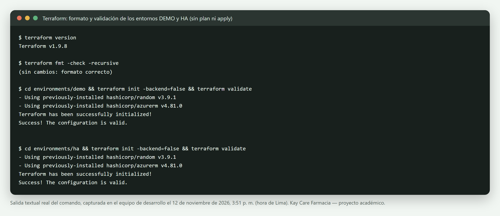

## 17. Automatización CI/CD

**CI frente a CD.** La CI responde a la pregunta «¿este cambio funciona?»: prueba y valida automáticamente. La CD responde a «¿publico esta versión?» y la despliega en un entorno. En Kay Care, la CI es automática y la CD es **manual y autorizada**.

**Workflow `pharmacy-ci.yml`.** Se dispara con un *push* a `main` o a las ramas `feat/academic-pharmacy-**`, y con *pull requests* que tocan la farmacia. Tiene 6 jobs:

1. **Backend:** Pint (estilo) y PHPUnit sobre PostgreSQL y SQLite, más la auditoría de dependencias.
2. **Frontend:** ESLint, vue-tsc (tipos), Vitest y compilación con Vite.
3. **Terraform:** `fmt -check` y `validate` para DEMO y HA.
4. **Workflows:** actionlint, más una comprobación de que `pharmacy-deploy` siga siendo solo manual y de que la CI nunca se autentique en Azure.
5. **Imágenes:** construye las imágenes Docker, levanta el sistema con Docker Compose, ejecuta el smoke test, la prueba de concurrencia y la de persistencia, y desde `main` publica las imágenes en GHCR. Ninguno de estos pasos usa Azure.

**Workflow `pharmacy-deploy.yml` (CD).**
- Solo se ejecuta **a mano** (`workflow_dispatch`) y solo desde `main`.
- Se autentica en Azure con OIDC, sin contraseñas guardadas.
- Guarda el `plan` como artefacto.
- El `apply` exige dos cosas: escribir `DESPLEGAR-<entorno>` en el campo de confirmación y la aprobación del GitHub Environment correspondiente.

**Nunca se ha ejecutado** (Figura 7).

```yaml
on:
  workflow_dispatch:   # único disparador: nunca por push, merge, tag ni programación
```

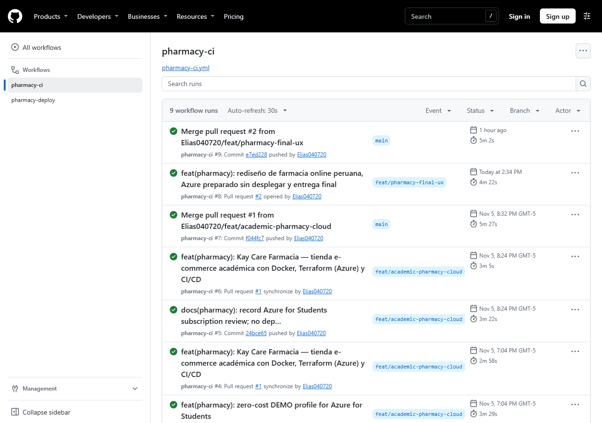

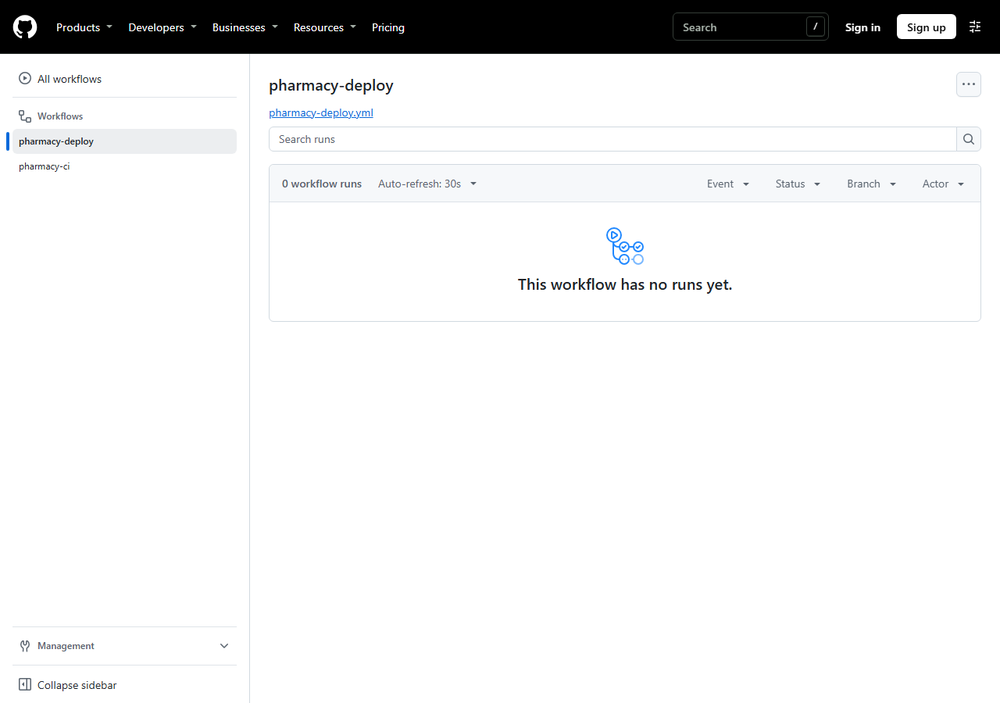

## 18. Seguridad

**Tabla 7.** Medidas implementadas.

| Medida | Implementación |
|---|---|
| HTTPS | Previsto: el ingress de Azure Container Apps emite el certificado; nginx agrega HSTS cuando la petición llega por HTTPS. En local se usa HTTP. |
| Validación de formularios | Form Requests de Laravel en todos los endpoints; el alias rechaza números con forma de DNI o teléfono |
| Autenticación administrativa | Sesión con guard propio y Sanctum; sin registro público; contraseña con bcrypt |
| Control de acceso | Middleware `auth:sanctum` + `EnsureAdmin` en `/admin/*`; guardia de rutas en el frontend |
| Protección de sesiones | Cookie `HttpOnly`, cifrada y `SameSite=Lax`; `Secure` en producción; token CSRF obligatorio |
| Gestión de secretos | `.env` fuera de Git; en Azure, `APP_KEY` y contraseñas generadas por Terraform como secretos; OIDC sin claves guardadas en GitHub |
| Seguridad de la base de datos | Red interna en Docker; TLS obligatorio en Azure; usuario propio; consultas parametrizadas |
| Validación de inventario | Precios y stock calculados en el servidor dentro de una transacción |
| Rate limiting | 120 solicitudes/min en el catálogo, 10/min en el checkout, 5/min en el login por correo + IP |
| Cabeceras | CSP `script-src 'self'`, `X-Frame-Options: DENY`, `nosniff`, `Referrer-Policy` |
| Contenedores | Sin root, solo lectura, sin capacidades, `no-new-privileges` |
| Producción | El contenedor se niega a arrancar con `APP_DEBUG=true` |

**Tabla 8.** Principales amenazas y mitigaciones. La matriz completa, con 22 amenazas, está en `docs/security/threat-matrix.md`.

| Amenaza | Mitigación |
|---|---|
| Inyección SQL | Consultas parametrizadas y comodines de `LIKE` escapados |
| XSS | Escape automático de Vue, prohibición de `v-html` (regla de ESLint) y CSP estricta |
| CSRF | Token de Sanctum y cookie `SameSite` |
| Fuerza bruta en el login | Límite de 5 intentos por minuto y mensaje genérico |
| Sobreventa por concurrencia | Bloqueo de filas y `CHECK (stock >= 0)` |
| Pedidos duplicados por reintento | Clave de idempotencia única |
| Manipulación de precios desde el navegador | El servidor ignora los precios del cliente y los recalcula |
| Exposición de la base de datos | Red interna en Docker y acceso con TLS en Azure |
| Fuga de secretos | `.env` y estado de Terraform ignorados por Git |

**Riesgos aceptados en el entorno académico:**
- no hay WAF;
- los secretos se guardan en Container Apps y no en Key Vault;
- no hay MFA para el administrador demo;
- PostgreSQL de DEMO tiene acceso público, con TLS y firewall limitado a servicios de Azure.

## 19. Alta disponibilidad

**Qué significa.** Alta disponibilidad (HA) es la capacidad del sistema de seguir atendiendo aunque falle una de sus partes. Se logra eliminando los puntos únicos de fallo con redundancia.

**Por qué una sola instancia puede fallar.** Un contenedor puede detenerse por un error, por falta de memoria o por mantenimiento del servidor. Un centro de datos puede tener cortes de energía o de red. Si solo existe una copia del servicio, cualquiera de esos eventos detiene la tienda.

**Réplicas y balanceador.** Una réplica es otra copia idéntica del mismo contenedor. El balanceador de carga (en Azure, el ingress de Container Apps) reparte las solicitudes entre las réplicas y, mediante los health checks, deja de enviar tráfico a las que no responden.

**Zonas de disponibilidad.** Una región de Azure se divide en zonas: centros de datos físicamente separados, con energía y red independientes. Si las réplicas están en zonas distintas, la caída de una zona no detiene el servicio.

**Qué ocurre cuando falla una réplica.** Las réplicas restantes siguen respondiendo, el balanceador las usa a ellas, y la plataforma crea una réplica nueva para recuperar el número mínimo configurado.

**Por qué PostgreSQL también necesita redundancia.** Si solo se duplica la API pero la base de datos es única, ella se convierte en el punto único de fallo. Por eso el diseño HA usa PostgreSQL Flexible Server en modo **ZoneRedundant**: un servidor primario en una zona y otro en espera en otra zona, con replicación síncrona y conmutación automática.

**Tabla 9.** Diferencia entre DEMO y HA.

| Componente | DEMO (costo mínimo) | HA (diseñada) |
|---|---|---|
| Réplicas web / API | 0–1 / 0–1 (escala a cero) | 2–6 / 3–10 |
| Zonas de disponibilidad | No | Sí, 3 zonas |
| PostgreSQL | B1ms, servidor único | General Purpose con réplica síncrona en otra zona |
| Red | Gestionada por Azure | VNet privada con DNS privado |
| Copias de seguridad | 7 días, locales | 35 días, geo-redundantes |

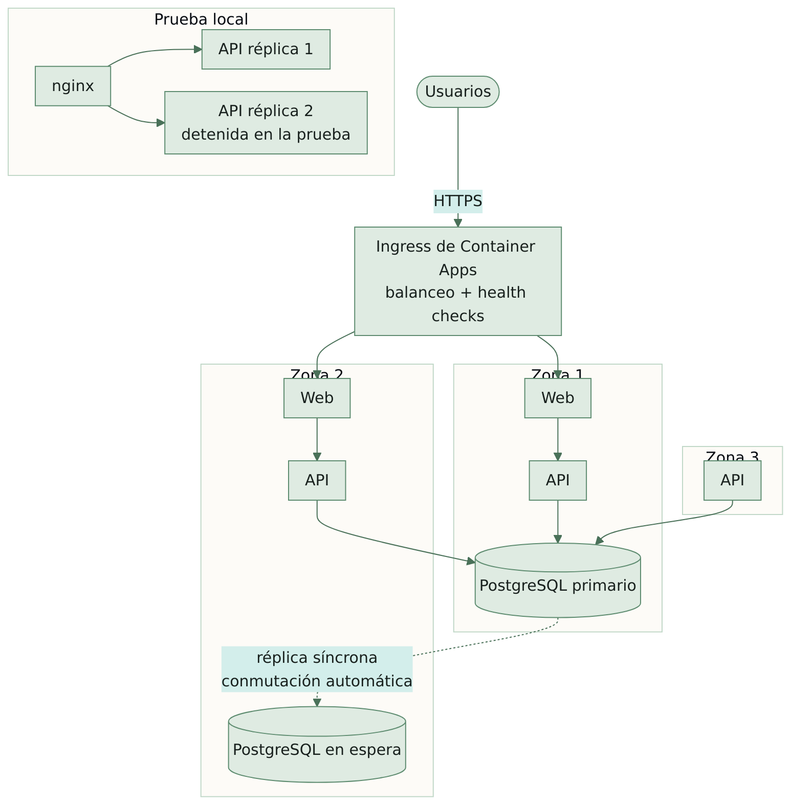

**Estado real de la alta disponibilidad:**

| Nivel | Estado |
|---|---|
| HA **diseñada** con Terraform (`environments/ha`) | Sí; `terraform validate` exitoso |
| HA **probada localmente** (`scripts/ha-local-test.sh`) | Sí: con 2 réplicas de la API y una detenida con tráfico en curso, respondieron **179 de 180 solicitudes**; se perdió 1 (timeout) en el instante del fallo y ninguna después |
| HA **desplegada y verificada en Azure** | **No** |

El entorno DEMO **no tiene alta disponibilidad**: tiene una sola base de datos y no usa zonas. Incluso el diseño HA protege ante la pérdida de una zona, pero no ante la caída de una región completa.

## 20. Implementación en Azure

**Arquitectura prevista.** El contenedor web se publica con ingress externo HTTPS y la API con ingress interno. Ambos viven en un entorno de Azure Container Apps conectado a PostgreSQL Flexible Server y a Log Analytics. Las imágenes se descargan de GHCR.

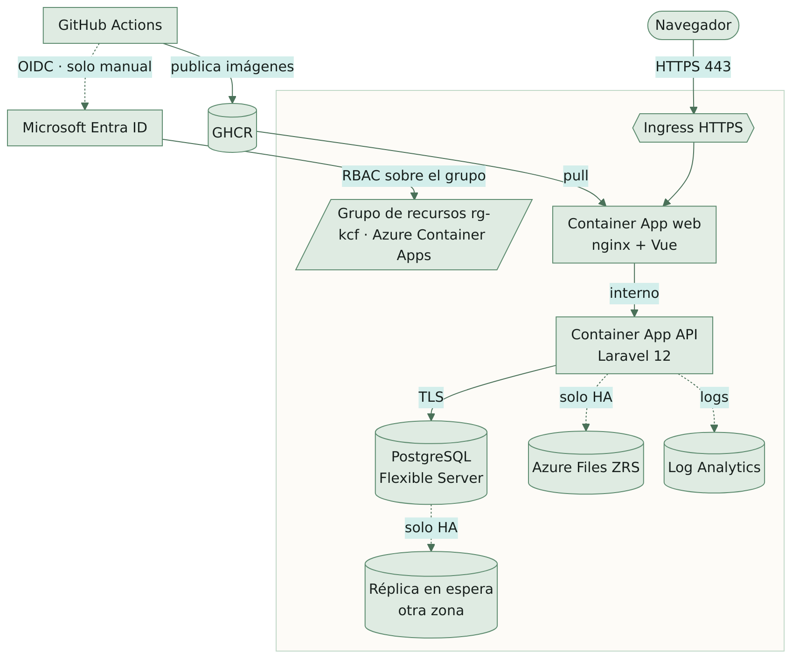

**Flujo de despliegue previsto para el día de la exposición** (`docs/deploy/DIA-EXPOSICION.md`):

1. **Preparación sin costo.** La CI publica las imágenes desde `main`. Se inicia sesión en Azure.
2. **`scripts/azure-preflight.ps1`, de solo lectura.** Verifica:
   - herramientas, sesión y suscripción;
   - región permitida y proveedores;
   - que `rg-kcf-demo` no exista;
   - disponibilidad de PostgreSQL B1ms;
   - que las imágenes sean públicas;
   - `terraform validate`;
   - costo estimado con la API oficial de precios de Azure.
3. **`scripts/deploy-azure.ps1`:**
   1. pide escribir el nombre de la suscripción;
   2. ejecuta el preflight;
   3. muestra el plan, y se detiene si algún recurso queda fuera de `rg-kcf-demo`;
   4. muestra el costo;
   5. exige escribir la frase `DESPLEGAR KCF-DEMO EN <suscripción>`;
   6. aplica el plan;
   7. espera los health checks;
   8. ejecuta un smoke test y una compra simulada de punta a punta;
   9. muestra la URL pública y los recursos que siguen cobrando.
4. **Retiro el mismo día.** Se ejecuta `terraform plan -destroy` sobre el mismo estado, se revisa y se aplica.

Ninguno de los dos scripts se ha ejecutado. Se comprobó en solo lectura que en la suscripción **no existe ningún recurso de Kay Care Farmacia**.

## 21. Costos

**Tabla 10.** Costos por escenario. Precios de lista para `canadacentral`, consultados en la API oficial de precios de Azure (Microsoft, 2026c) el 12 de noviembre de 2026.

| Escenario | Costo | Condiciones |
|---|---|---|
| Desarrollo local | US$ 0 de nube | Docker en el equipo del estudiante |
| DEMO, día de la exposición | ≈ US$ 0,60 | 8 h de vida, 4 h con tráfico, retiro el mismo día |
| DEMO durante 24 h | ≈ US$ 1,20 | PostgreSQL encendido todo el día |
| DEMO olvidado un mes | ≈ US$ 18–20 | Principalmente PostgreSQL B1ms |
| HA (solo diseño) | ≈ US$ 650–700/mes | PostgreSQL con HA y réplicas mínimas siempre activas |

**Precios unitarios usados:**
- Container Apps: US$ 0,000034 por vCPU·s activa y US$ 0,000004 por GiB·s.
- PostgreSQL B1ms: US$ 0,0185 por hora; almacenamiento a US$ 0,1265 por GB·mes.
- Log Analytics: US$ 2,76 por GB ingerido, tras los 5 GB gratuitos de la cuenta.

**Cómo se consumen créditos de Azure for Students:**
- **Cobra aunque no haya visitantes:** el cómputo y el almacenamiento de PostgreSQL, y la ingesta de logs.
- **No cobra:** Container Apps mientras está escalado a cero.
- **No se asume gratuidad.** La concesión gratuita mensual de Container Apps la consumen otras aplicaciones de la misma suscripción, y las horas gratuitas de PostgreSQL de la oferta de estudiante no pudieron verificarse.
- El presupuesto de US$ 1 configurado en Terraform **avisa por correo, pero no detiene** los recursos: para dejar de consumir hay que retirarlos.

**Consumo de créditos de Azure de Kay Care Farmacia hasta la fecha: US$ 0.** No se ha creado ningún recurso.

## 22. Pruebas y resultados

**Tabla 11.** Pruebas ejecutadas el 12 de noviembre de 2026.

| Prueba | Resultado | Evidencia |
|---|---|---|
| Backend: catálogo, ofertas, stock, pedidos, transacciones, idempotencia, autenticación, seguridad, seeders | 70 pruebas / 415 aserciones OK en PostgreSQL 16 y SQLite | `backend/tests` · Figura 10 |
| Frontend: inicio, buscador, catálogo, tarjetas, carrito, checkout, guardia admin, accesibilidad | 45 pruebas OK | `frontend/src/**/*.test.ts` · Figura 10 |
| Recorrido de compra completo en navegador real (sin simulaciones) | 3/3 recorridos OK; 0 violaciones de accesibilidad en 6 páginas | `frontend/e2e/evidence.spec.ts` · Figuras 11–17 |
| Pedido en la base de datos | Pedido KCF-2026-000026 guardado, con movimiento de stock −2 (34 → 32) | Consulta `psql` |
| Carrito y checkout: stock insuficiente, alias inválido, idempotencia | Rechazos 409/422 y repetición sin duplicado | Pruebas PHPUnit y Vitest |
| Compras simultáneas | 9 compras con stock 4 → 4 creadas, 5 rechazadas, stock final 0 | `scripts/concurrency-check.mjs` |
| Docker | 3 servicios saludables; usuarios 10001 y 101; red de datos interna | Figura 4 |
| Persistencia | 25 pedidos antes y después de reconstruir los contenedores | Volumen `pharmacy_pgdata` |
| Seguridad (smoke test) | 18/18: CSP, X-Frame-Options, CSRF 419, admin 401, cookie HttpOnly… | `scripts/smoke-test.sh` |
| Tolerancia a fallos local | 179/180 solicitudes con una réplica caída | `scripts/ha-local-test.sh` |
| Terraform | `fmt`, `init -backend=false` y `validate` OK en DEMO y HA | Figura 5 |
| GitHub Actions | CI de la PR y de `main` en verde (6 jobs) | Figura 6 |
| Aislamiento del sistema clínico | 0 archivos modificados; sus pruebas pasan 108/108 | Figura 18 |

**Hallazgos durante las pruebas:**
- La primera ejecución de la prueba de alta disponibilidad mostró fallos que resultaron ser el límite de 120 solicitudes por minuto de la propia API, no la conmutación entre réplicas. El script se ajustó a un ritmo inferior al límite y ahora registra el código HTTP de cada fallo.
- Las pruebas de accesibilidad de versiones anteriores detectaron contrastes insuficientes, que se corrigieron.

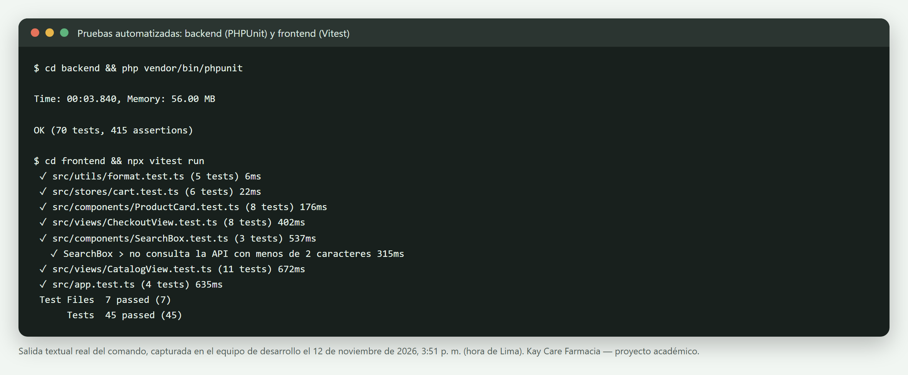

## 23. Evidencias

Todas las capturas son reales. Se generaron con Playwright contra el sistema en Docker (`http://localhost:8088`) y están en `docs/evidence/`.

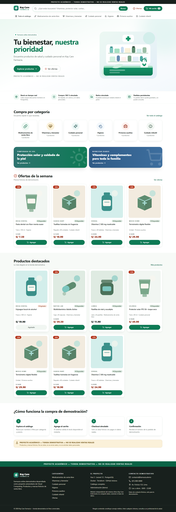

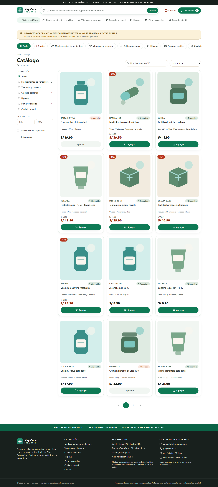

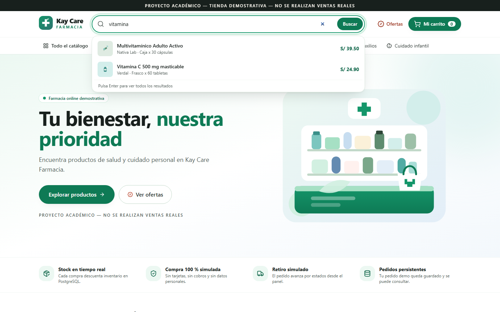

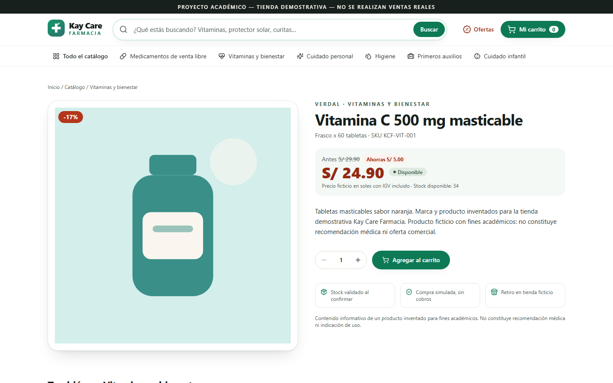

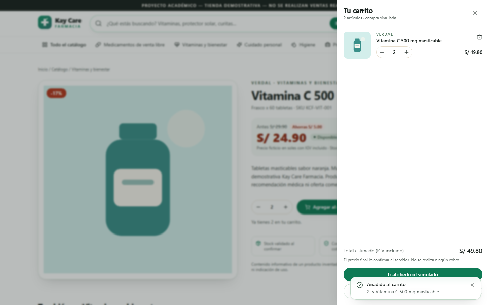

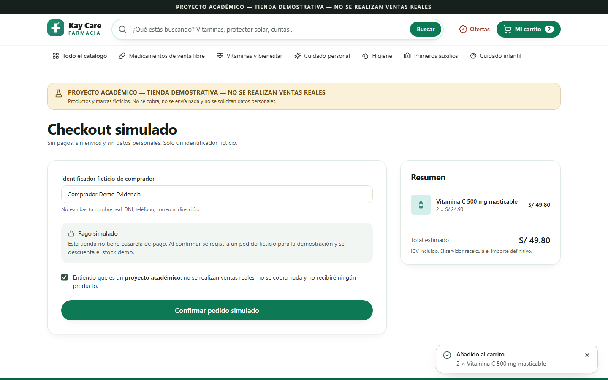

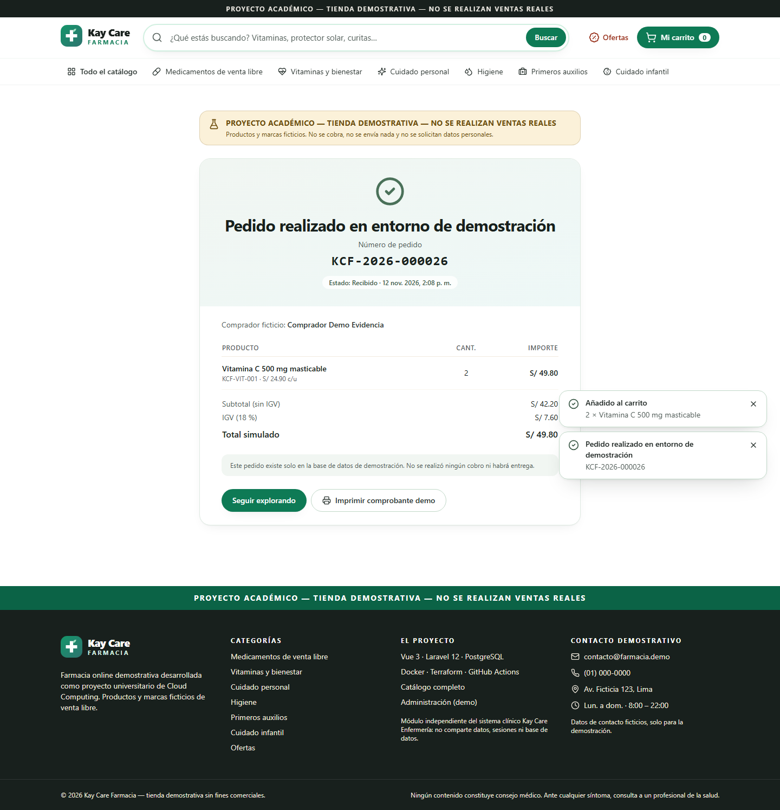

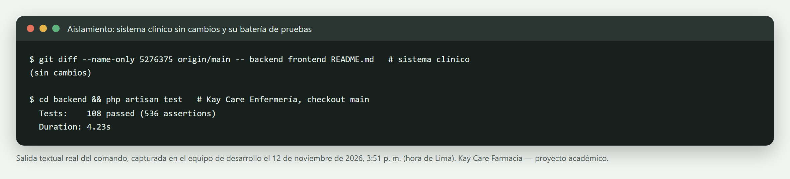

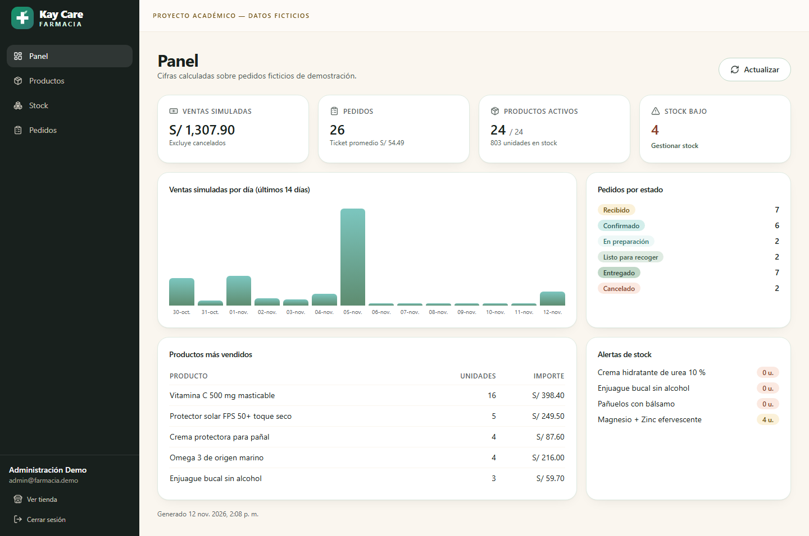

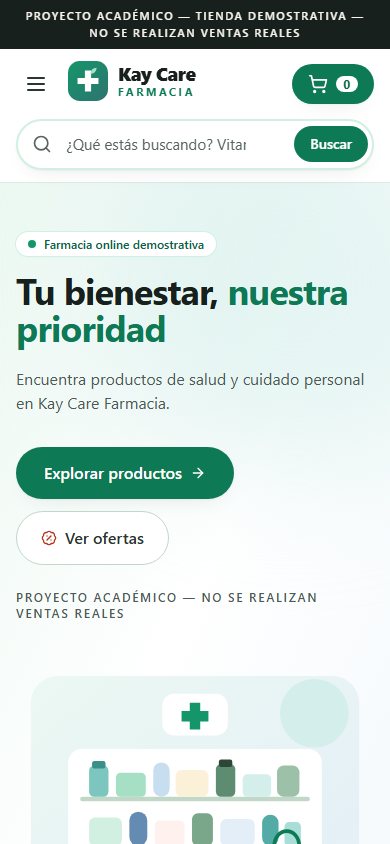

**Enlace público:** pendiente del despliegue durante la exposición. Se registrará aquí solo después de verificar que responde. Ejecución local: `http://localhost:8088`.

## 24. Conclusiones

1. Se implementó una plataforma e-commerce farmacéutica funcional, con catálogo, búsqueda, carrito, checkout simulado y administración conectados a una API y una base de datos reales, verificada con 70 pruebas de backend, 45 de frontend y 3 recorridos completos en navegador.
2. La combinación de transacción, bloqueo de filas, restricciones de la base de datos y claves de idempotencia evitó la sobreventa y los pedidos duplicados en la prueba de compras simultáneas.
3. La contenerización con Docker permitió levantar el sistema completo con un solo comando, con servicios aislados, sin privilegios de root y con datos persistentes.
4. Terraform permitió dejar la infraestructura de Azure descrita, validada y estimada sin crear recursos ni consumir créditos: la nube se puede preparar antes de pagar por ella.
5. La alta disponibilidad quedó diseñada y probada localmente en la capa de API, pero no se desplegó en Azure por su costo (≈ US$ 650–700/mes). Eso muestra que la disponibilidad tiene un precio que debe justificarse según el nivel de servicio requerido.

## 25. Recomendaciones

**Mejoras futuras:**
- Realizar el despliegue autorizado y medir en la nube la latencia, el arranque en frío y la disponibilidad.
- Guardar los secretos en **Azure Key Vault** con identidad gestionada.
- Incorporar **Azure Front Door con WAF** delante del ingress.
- Ejecutar las migraciones en un *job* dedicado, en lugar de al arrancar la API.
- Usar **Redis** para sesiones y caché, reduciendo la dependencia de PostgreSQL.
- Agregar **MFA** para el administrador.
- Diseñar una arquitectura **multi-región** activa-pasiva.
- Ejecutar pruebas de carga.

**Limitaciones:**
- No hay pagos, envíos ni cuentas de compradores.
- El entorno DEMO tiene puntos únicos de fallo.
- La prueba de alta disponibilidad fue local y solo en la capa de API.
- La URL pública depende del despliegue el día de la exposición.

## 26. Referencias

Beyer, B., Jones, C., Petoff, J., & Murphy, N. R. (Eds.). (2016). *Site reliability engineering: How Google runs production systems*. O'Reilly Media.

Docker Inc. (2026). *Docker documentation*. https://docs.docker.com/

GitHub. (2026a). *GitHub Actions documentation*. https://docs.github.com/actions

GitHub. (2026b). *Security hardening your deployments with OpenID Connect*. https://docs.github.com/actions/security-for-github-actions/security-hardening-your-deployments/about-security-hardening-with-openid-connect

HashiCorp. (2026a). *Terraform documentation*. https://developer.hashicorp.com/terraform/docs

HashiCorp. (2026b). *AzureRM provider documentation*. https://registry.terraform.io/providers/hashicorp/azurerm/latest/docs

Humble, J., & Farley, D. (2010). *Continuous delivery: Reliable software releases through build, test, and deployment automation*. Addison-Wesley.

Laravel. (2026). *Laravel 12.x documentation*. https://laravel.com/docs/12.x

Mell, P., & Grance, T. (2011). *The NIST definition of cloud computing* (NIST Special Publication 800-145). National Institute of Standards and Technology. https://doi.org/10.6028/NIST.SP.800-145

Microsoft. (2026a). *Azure Container Apps documentation*. https://learn.microsoft.com/azure/container-apps/

Microsoft. (2026b). *High availability concepts in Azure Database for PostgreSQL – Flexible Server*. https://learn.microsoft.com/azure/postgresql/flexible-server/concepts-high-availability

Microsoft. (2026c). *Azure Retail Prices REST API*. https://learn.microsoft.com/rest/api/cost-management/retail-prices/azure-retail-prices

Microsoft. (2026d). *Billing in Azure Container Apps*. https://learn.microsoft.com/azure/container-apps/billing

Morris, K. (2020). *Infrastructure as code: Dynamic systems for the cloud age* (2nd ed.). O'Reilly Media.

OWASP Foundation. (2021). *OWASP Top 10:2021*. https://owasp.org/Top10/

PostgreSQL Global Development Group. (2026). *PostgreSQL 16 documentation: Explicit locking*. https://www.postgresql.org/docs/16/explicit-locking.html

Vue.js. (2026). *Vue.js guide*. https://vuejs.org/guide/

**Anexos en el repositorio** (`https://github.com/Elias040720/Kay-Care`, carpeta `academic-pharmacy/`): código fuente, `docker-compose.yml`, `infra/terraform/`, `.github/workflows/pharmacy-*.yml`, `docs/diagrams/`, `docs/evidence/`, `docs/security/threat-matrix.md`, `docs/architecture/demo-vs-ha.md`, `docs/report/costos.md` y `docs/deploy/DIA-EXPOSICION.md`.
