<!-- PORTADA EDITABLE: reemplace los campos entre corchetes (datos del estudiante y del docente). -->

<div class="portada">

**[NOMBRE DE LA UNIVERSIDAD]**
**[FACULTAD / ESCUELA PROFESIONAL]**

# Kay Care Farmacia: farmacia online académica con arquitectura modular contenerizada, preparada para Azure con alta disponibilidad diseñada e integración continua

**Curso:** [Nombre del curso]
**Docente:** [Nombre del docente]
**Integrantes:** [Apellidos y nombres — código]
**Ciclo / Sección:** [Ciclo] — [Sección]
**Lugar y fecha:** [Ciudad], noviembre de 2026

> PROYECTO ACADÉMICO — TIENDA DEMOSTRATIVA — NO SE REALIZAN VENTAS REALES

</div>

> **Nota sobre el título.** La solución se compone de dos servicios desplegables (frontend y API) y un backend organizado en módulos de dominio dentro de una sola aplicación Laravel. No es una arquitectura de microservicios; por ello el título habla de *arquitectura modular contenerizada*.

---

## Resumen

Se diseñó e implementó *Kay Care Farmacia*, una farmacia online demostrativa con productos ficticios de venta libre, sin pagos ni datos personales reales, desarrollada como módulo independiente dentro del repositorio Kay Care y aislada del sistema clínico de enfermería existente. La interfaz toma como referencia de navegación a las farmacias online peruanas (buscador central, menú de categorías, ofertas y tarjetas con «Agregar»), con identidad visual propia. La solución consta de una SPA en Vue 3 con TypeScript servida por nginx sin privilegios, una API REST en Laravel 12 y una base de datos PostgreSQL. El checkout se ejecuta en una única transacción con bloqueo pesimista de filas, precios calculados en el servidor y claves de idempotencia. La infraestructura se describe con Terraform en dos entornos de Azure —DEMO de costo mínimo y HA con redundancia de zona— y queda preparada, sin desplegar, junto con scripts de verificación previa (solo lectura) y de despliegue con confirmación explícita para el día de la exposición. Se verificaron 70 pruebas de backend sobre PostgreSQL 16, 45 pruebas de frontend, 3 recorridos E2E con Playwright contra Docker, una prueba de concurrencia sin sobreventa, una prueba local de tolerancia a fallos y la validación de ambos entornos Terraform. No se creó ningún recurso en Azure: la URL pública se obtendrá el día de la exposición.

**Palabras clave:** comercio electrónico, contenedores, Azure Container Apps, PostgreSQL, Terraform, CI/CD, idempotencia, alta disponibilidad.

## Abstract

*Kay Care Farmacia* is an academic, fictitious over-the-counter pharmacy store built as an isolated module of the Kay Care repository. It combines a Vue 3 + TypeScript SPA behind an unprivileged nginx, a Laravel 12 REST API and PostgreSQL. Checkout runs in a single database transaction with row-level locks, server-side pricing and idempotency keys. Its storefront follows the navigation patterns of Peruvian online pharmacies with an original visual identity. Infrastructure is defined with Terraform for two Azure environments (minimum-cost DEMO and zone-redundant HA), plus a read-only preflight script and a confirmation-gated deployment script reserved for the presentation day; the deployment workflow is manual-only. Automated tests, end-to-end runs against Docker, a concurrency test, a local fault-tolerance test and Terraform validation were verified locally; no Azure resources were created.

---

## 1. Introducción

El comercio electrónico de productos de cuidado personal exige consistencia de inventario, seguridad y disponibilidad. Este proyecto construye una tienda demostrativa que permite estudiar esos requisitos de extremo a extremo —desde la interfaz hasta la nube— sin riesgos legales ni éticos: todos los productos y marcas son inventados, no existe pasarela de pago y no se solicitan datos personales.

## 2. Planteamiento del problema

El repositorio Kay Care ya contiene un sistema clínico de enfermería en producción académica. Se requiere añadir un módulo de e-commerce **sin alterar** ese sistema, sin compartir base de datos, sesiones ni credenciales, y demostrar prácticas de ingeniería de nube: contenedores, infraestructura como código, CI/CD y alta disponibilidad, con costos controlados.

## 3. Justificación

- **Académica:** integra contenidos de desarrollo web, bases de datos transaccionales, seguridad, DevOps y arquitectura de nube en un caso realista.
- **Técnica:** problemas como la sobreventa o los pedidos duplicados por reintentos son frecuentes en tiendas reales y se resuelven aquí con mecanismos verificables.
- **Económica:** el entorno DEMO cuesta del orden de US$ 0,60 por un día de exposición si se retira ese mismo día, y no se crea hasta que se autorice.

## 4. Objetivos

**General.** Desarrollar y documentar una tienda e-commerce académica, segura y reproducible, preparada para desplegarse en Azure en dos niveles de disponibilidad.

**Específicos.**
1. Implementar una farmacia online con apariencia realista (buscador, categorías, ofertas) y catálogo con búsqueda, filtros, ordenamiento y stock; carrito; checkout simulado y confirmación.
2. Garantizar consistencia del inventario mediante transacciones, bloqueo e idempotencia.
3. Implementar un panel de administración autenticado con CRUD, stock y pedidos.
4. Contenerizar la solución con imágenes sin root y health checks.
5. Definir la infraestructura en Terraform para los entornos DEMO y HA y dejarla lista para desplegarse el día de la exposición sin consumir créditos antes.
6. Automatizar la integración y dejar el despliegue exclusivamente manual, con permisos mínimos, confirmación escrita y aprobación humana.
7. Verificar con pruebas automatizadas y documentar riesgos, costos y puntos únicos de fallo.

## 5. Alcance y limitaciones

**Incluye:** las páginas públicas y de administración, la API `/api/v1/store`, Docker Compose, Terraform (módulos y dos entornos), los scripts del día de la exposición (`azure-preflight.ps1`, `deploy-azure.ps1`), dos workflows y la documentación.

**No incluye:** pagos reales, envíos, cuentas de compradores, facturación electrónica ni un despliegue en Azure durante el desarrollo: se realizará solo el día de la exposición con autorización expresa del titular de la suscripción. La disponibilidad del entorno HA es la que ofrece el diseño; **no se midió en la nube**.

## 6. Marco teórico

- **Arquitectura modular:** separación por módulos de dominio (catálogo, checkout, inventario, pedidos, administración) dentro de una aplicación desplegable, con contratos claros entre capas.
- **Transacciones ACID y bloqueo pesimista:** `SELECT … FOR UPDATE` serializa el acceso a las filas de producto durante el checkout.
- **Idempotencia:** una operación repetida con la misma clave produce el mismo resultado sin efectos adicionales (patrón usado por pasarelas de pago).
- **Contenedores y orquestación serverless:** Azure Container Apps ejecuta contenedores con escalado automático (incluso a cero) sobre un entorno gestionado.
- **Infraestructura como código:** Terraform describe recursos de forma declarativa, versionable y revisable.
- **Alta disponibilidad por zonas:** distribuir réplicas y bases de datos en zonas de disponibilidad independientes dentro de una región.
- **CI/CD con OIDC:** GitHub Actions obtiene credenciales temporales de Microsoft Entra ID mediante federación, sin secretos de larga duración.

## 7. Requisitos funcionales

| ID | Requisito |
|---|---|
| RF-01 | Inicio con hero, beneficios, categorías con iconos, banners, ofertas y productos destacados. |
| RF-02 | Catálogo con búsqueda por nombre/marca/SKU, filtros por categoría, precio, disponibilidad y ofertas, ordenamiento y paginación. |
| RF-03 | Detalle de producto con stock y productos relacionados. |
| RF-04 | Carrito en panel lateral con cantidades y validación de stock contra el servidor. |
| RF-05 | Checkout simulado con identificador ficticio, sin DNI, dirección ni datos bancarios. |
| RF-06 | Confirmación con número de pedido. |
| RF-07 | Login de administrador sin registro público. |
| RF-08 | Dashboard con indicadores calculados sobre datos demo. |
| RF-09 | CRUD de productos con validación de imágenes. |
| RF-10 | Gestión de stock auditada. |
| RF-11 | Gestión de pedidos con máquina de estados. |
| RF-12 | Aviso «PROYECTO ACADÉMICO — TIENDA DEMOSTRATIVA — NO SE REALIZAN VENTAS REALES» en todas las páginas públicas (barra superior y pie). |
| RF-13 | Buscador del encabezado con sugerencias en vivo, navegable con teclado. |
| RF-14 | Promociones ficticias: precio anterior, porcentaje de descuento y filtro «Ofertas». |
| RF-15 | Confirmación «Pedido realizado en entorno de demostración» con el pedido guardado en la base de datos. |

## 8. Requisitos no funcionales

| ID | Requisito | Cómo se cumple |
|---|---|---|
| RNF-01 Seguridad | OWASP básico | Sección 18 y matriz de amenazas |
| RNF-02 Consistencia | Sin sobreventa ni duplicados | Sección 17 |
| RNF-03 Disponibilidad | Tolerar la caída de una zona (HA) | Sección 24 |
| RNF-04 Accesibilidad | Navegación por teclado, contraste, etiquetas | axe sin violaciones (sección 25) |
| RNF-05 Rendimiento percibido | Skeletons, animaciones transform/opacity, `prefers-reduced-motion` | Frontend |
| RNF-06 Portabilidad | `docker compose up --build` | Sección 20 |
| RNF-07 Costo | Cero consumo antes de la exposición; DEMO de costo mínimo ese día | Sección 26 |
| RNF-08 Aislamiento | Nada compartido con el sistema clínico | Sección 27 |

## 9. Metodología de trabajo

Desarrollo iterativo con control de versiones en Git: rama `feat/academic-pharmacy-cloud` creada desde `main` en un *worktree* separado, commits por incremento (backend → frontend → contenedores → infraestructura → CI/CD → documentación) y verificación automatizada al cierre de cada incremento. La fase de finalización (rediseño de la interfaz, preparación de Azure y documentación) se desarrolló en la rama `feat/pharmacy-final-ux`, integrada mediante pull request. La coordinación con otros agentes que trabajan en el repositorio se realizó reservando exclusivamente la ruta `academic-pharmacy/` y los workflows `pharmacy-*`.

## 10. Arquitectura de la solución

| Capa | Tecnología | Responsabilidad |
|---|---|---|
| Presentación | Vue 3, TypeScript, Vite, Tailwind, Vue Router, Pinia, Lucide | SPA pública y panel |
| Borde | nginx-unprivileged 1.27 | Archivos estáticos, CSP y cabeceras, proxy de `/api` (mismo origen) |
| Aplicación | Laravel 12 sobre FrankenPHP (PHP 8.3) | API REST, Form Requests, servicios de dominio |
| Datos | PostgreSQL 16 | Catálogo, pedidos, movimientos, sesiones y caché |
| Archivos | Volumen Docker (local) · disco efímero (DEMO) · Azure Files ZRS (HA) | Imágenes subidas por el administrador |

**Módulos de dominio del backend:** `Catalog\ProductSearch`, `Checkout\CartPricer`, `Checkout\CheckoutService`, `Inventory\StockService`, `Orders\OrderStatusService`, `Admin\DashboardService`.

El navegador habla con **un solo origen**: nginx sirve la SPA y reenvía `/api` a la API interna. Así la cookie de sesión es de primera parte, el CSRF de Sanctum funciona sin CORS permisivo y la API no se expone a Internet.

## 11. Diseño de la base de datos

| Tabla | Propósito | Restricciones relevantes |
|---|---|---|
| `admin_users` | Única identidad autenticable | email único, contraseña bcrypt |
| `categories` | Categorías | slug único |
| `products` | Productos ficticios | SKU y slug únicos; `CHECK stock >= 0`; `CHECK price_cents > 0`; precios en céntimos (entero); `compare_at_price_cents` opcional para ofertas (solo se muestra si es mayor que el precio) |
| `orders` | Pedidos simulados | número único, `idempotency_key` **única**, `request_hash`, `lookup_token`, `CHECK status IN (…)` |
| `order_items` | Líneas con instantánea de nombre/SKU/precio | `CHECK quantity > 0` |
| `order_status_history` | Auditoría de estados | administrador y nota |
| `stock_movements` | Auditoría de inventario | delta, stock resultante, motivo, referencia |
| `sessions`, `cache`, `cache_locks`, `jobs` | Infraestructura Laravel | — |

Los importes se guardan como enteros en céntimos de sol para evitar errores de redondeo de coma flotante. El IGV (18 %) está incluido en el precio de lista y se desglosa como `round(total × 18 / 118)`.

## 12. Diseño de la API REST

Prefijo `/api/v1/store`. Errores uniformes `{ message, code, details | errors }`.

| Método | Ruta | Descripción | Protección |
|---|---|---|---|
| GET | `/health` | Salud (incluye BD) | — |
| GET | `/categories`, `/products` (`q`, `category`, `min_price`, `max_price`, `in_stock`, `on_sale`, `sort`, `page`), `/products/{slug}`, `/products/{slug}/related` | Catálogo | 120/min |
| POST | `/cart/validate` | Precios y stock actuales | 120/min, CSRF |
| POST | `/checkout` | Pedido simulado | `Idempotency-Key`, 10/min, CSRF |
| GET | `/orders/{número}?token=` | Confirmación | token opaco |
| GET | `/sanctum/csrf-cookie` | Cookie CSRF | — |
| POST | `/admin/login`, `/admin/logout`; GET `/admin/me` | Sesión | 5/min login |
| GET | `/admin/dashboard` | Indicadores | sesión |
| GET/POST/PUT/DELETE | `/admin/products[/{id}]`, POST `/image`, POST `/stock` | Productos y stock | sesión |
| GET | `/admin/stock-movements` | Auditoría | sesión |
| GET/PATCH | `/admin/orders[/{id}][/status]` | Pedidos | sesión |

Códigos de dominio: `insufficient_stock` (409), `product_unavailable` (422), `idempotency_conflict` (409), `invalid_status_transition` (422), `negative_stock` (422), `product_has_orders` (409), `too_many_requests` (429), `csrf_token_mismatch` (419).

## 13. Diseño de la interfaz (UI/UX)

**Referencia de UX.** Se analizaron como referencia de navegación las farmacias online peruanas Mifarma e Inkafarma, sin copiar logotipos, imágenes, textos ni diseños exactos. Se adoptaron patrones habituales del sector: barra de aviso superior, buscador central grande, menú horizontal de categorías, banners promocionales, tarjetas con precio y botón «Agregar», etiquetas de descuento y pie con categorías y contacto. La identidad de *Kay Care Farmacia* es propia: logotipo original (cruz redondeada con hoja), ilustración vectorial de farmacia e ilustraciones de producto dibujadas para el proyecto.

**Sistema visual.** Blanco limpio como base, verde clínico `#0E7A55` para acciones, verde salvia, turquesa suave y azules discretos (`#2F5B86`) para banners, y rojo `#B4361C` solo para ofertas. Tipografía sans moderna con títulos en negrita, tarjetas redondeadas y sombras suaves. Todas las combinaciones de texto y fondo cumplen el contraste AA (axe sin violaciones).

**Componentes.** `AppHeader` (aviso, logo, `SearchBox` con sugerencias en vivo tipo *combobox* ARIA, acceso a ofertas, carrito con contador animado, menú de categorías y menú lateral móvil), `HeroIllustration`, `ProductCard` (etiqueta de descuento, precio tachado, disponibilidad, botón «Agregar» con confirmación inmediata), `CartDrawer`, `AppFooter` (categorías, información del proyecto, contacto ficticio identificado como demostrativo y aviso académico).

**Movimiento.** Elevación de tarjetas al pasar el cursor, transición entre páginas, carrito lateral animado, «salto» del contador al agregar, *skeletons* y entradas discretas. Solo se anima `transform`/`opacity`, y todo se desactiva con `prefers-reduced-motion`. Todos los botones ejecutan una acción real; el carrito lateral atrapa el foco, se cierra con Escape y devuelve el foco al disparador.

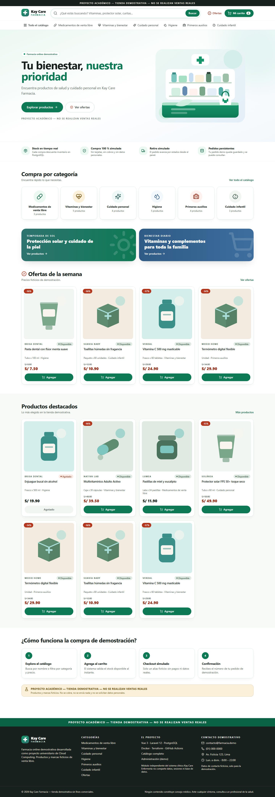

## 14. Flujo de compra (diagrama A)

Recorrido Inicio → Catálogo → Buscar → Agregar al carrito → Verificar stock → Checkout simulado → Guardar pedido → Confirmación, con sus caminos de error: filtros inválidos, sin resultados, producto agotado, stock insuficiente, alias no válido, límite de intentos y fallo de red con reintento idempotente.

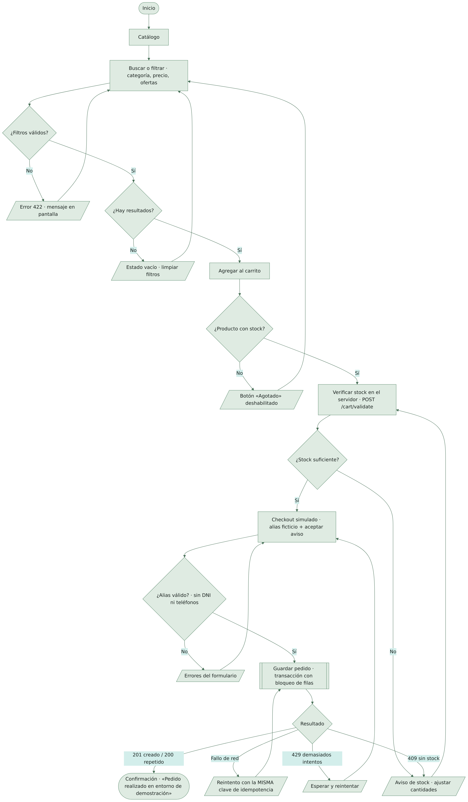

El detalle técnico, que incluye códigos HTTP, transacción y panel de administración, está en `docs/diagrams/export/a-program-flow.png` (diagrama A2).

## 15. Implementación del backend

- **Form Requests** validan toda entrada: filtros del catálogo (lista blanca de ordenamientos, rangos de precio), carrito (1–10 unidades, ≤ 20 líneas), checkout (alias ficticio, cabecera `Idempotency-Key`, aceptación del aviso), productos, imágenes, stock y estados.
- **Servicios de dominio** encapsulan la lógica; los controladores solo orquestan.
- **Autenticación** por sesión con un guard `admin` propio y Sanctum en modo SPA; middleware `EnsureAdmin` como defensa adicional.
- **Seeders** idempotentes: 6 categorías (Medicamentos de venta libre, Vitaminas y bienestar, Cuidado personal, Higiene, Primeros auxilios, Cuidado infantil), 24 productos ficticios (6 con oferta) y 18 pedidos creados a través del mismo servicio de checkout (stock e historial coherentes). Una migración de datos de una sola ejecución renombra las categorías de una base existente sin duplicarlas ni pisar los cambios hechos desde la administración.
- **Ofertas:** `compare_at_price_cents` es solo informativo; el checkout cobra siempre (simuladamente) el precio vigente calculado en el servidor (prueba `test_checkout_charges_current_price_not_compare_at_price`).
- **Observabilidad:** logs a `stderr`, `X-Request-Id` en cada respuesta y en el contexto de log.

## 16. Implementación del frontend

- Router con carga diferida por vista y guardia para `/admin` (redirección al login con retorno seguro, sin *open redirect*).
- Stores de Pinia: carrito (persistido en `localStorage` con validación de datos corruptos), catálogo (categorías compartidas por encabezado, inicio, catálogo y pie, pedidas una sola vez), toasts y sesión.
- Buscador con *debounce* de 250 ms y cancelación de peticiones obsoletas (`AbortController`); siempre consulta la API real.
- Cliente HTTP con manejo de CSRF (reintento único ante 419) y errores normalizados.
- El checkout reutiliza la misma clave de idempotencia mientras el contenido del carrito no cambie, de modo que un reintento tras un fallo de red no duplica el pedido.

## 17. Transacciones, concurrencia e idempotencia

1. Se normaliza el carrito (líneas fusionadas, ordenadas por id) y se calcula un hash SHA-256 del contenido.
2. Si la clave ya existe: mismo hash → se devuelve el mismo pedido (200, `Idempotency-Replayed: true`); hash distinto → 409.
3. En una transacción: `SELECT … FOR UPDATE` de los productos en orden ascendente (evita interbloqueos), verificación de stock y estado, cálculo de precios desde la fila bloqueada, inserción del pedido y sus líneas, descuento de stock y registro de movimientos.
4. Si dos peticiones simultáneas usan la misma clave, la restricción `UNIQUE` hace fallar a una; el servicio captura la violación y devuelve el pedido ganador.

**Verificación real (PostgreSQL 16 en Docker, 12-nov-2026):** 9 compras simultáneas de 1 unidad sobre un producto con stock 4 → **4 pedidos creados, 5 rechazados con 409, stock final 0** (`scripts/concurrency-check.mjs`, que elige automáticamente un producto con stock bajo). Una verificación anterior con stock 2 y 7 compras dio 2 creados y 5 rechazados.

## 18. Seguridad

HTTPS (ingress de Azure con certificado gestionado; HSTS cuando el tráfico llega por HTTPS), validación de entradas, protección XSS (escape de Vue, CSP `script-src 'self'`, prohibición de `v-html`), CSRF (Sanctum), inyección SQL (consultas parametrizadas y escape de comodines), contraseñas con bcrypt, rate limiting por ruta, CORS con lista blanca, cabeceras de seguridad en nginx y en la API, `APP_DEBUG=false` forzado en producción, secretos fuera de Git (generados por Terraform, OIDC en CI/CD) y contenedores sin root con sistema de archivos de solo lectura.

## 19. Matriz de amenazas y controles

La matriz completa (22 amenazas STRIDE con controles, evidencia, probabilidad e impacto residual) está en [`docs/security/threat-matrix.md`](../security/threat-matrix.md). Riesgos aceptados: sin WAF, secretos en Container Apps en lugar de Key Vault, sin MFA para el administrador demo y PostgreSQL público en DEMO.

## 20. Contenerización (Docker)

| Imagen | Base | Usuario | Health check |
|---|---|---|---|
| API | `composer:2.8` → `dunglas/frankenphp:1-php8.3-alpine` | `app` (UID 10001), sin `setcap` | `GET /api/v1/store/health` |
| Frontend | `node:20.18-alpine` → `nginxinc/nginx-unprivileged:1.27-alpine` | `nginx` (UID 101) | `GET /healthz` |

`docker-compose.yml` define tres servicios (db, backend, frontend), una red `data` **interna** (PostgreSQL sin salida ni puerto publicado), un volumen persistente `pharmacy_pgdata`, `read_only`, `cap_drop: ALL` y `no-new-privileges`. El entrypoint exige `APP_KEY`, rechaza `APP_DEBUG=true` en producción, espera a la base de datos, aplica migraciones (con bloqueo cuando ya existe el esquema) y carga datos demo idempotentes.

**Verificado (12-nov-2026):** arranque con health checks en verde; prueba de humo 18/18; persistencia al reconstruir los contenedores con el mismo volumen (25 pedidos antes y después, con la migración de datos aplicada); frontend sin acceso a la base de datos; procesos con UID 10001 y 101. La tienda queda disponible en **http://localhost:8088**.

## 21. Infraestructura como código (Terraform)

```
infra/terraform/
├── modules/ monitoring · network · postgres · container-environment · container-app
└── environments/
    ├── demo/  providers.tf versions.tf variables.tf main.tf outputs.tf terraform.tfvars.example
    └── ha/    (misma estructura)
```

Proveedores `azurerm ~> 4.14` (validado con 4.81.0) y `random ~> 3.6`. Las contraseñas y la `APP_KEY` se generan con `random_password`/`random_bytes` y se entregan como secretos de Container Apps; el administrador demo recibe una contraseña aleatoria que no se publica. El estado puede ser local (script del día de la exposición) o remoto con backend `azurerm` cifrado (workflow). **Resultado:** `terraform fmt -check` sin cambios y `terraform init -backend=false` + `terraform validate` exitosos en ambos entornos. **No se ejecutó `terraform plan` contra la suscripción, ni `apply`, ni `destroy`.**

**Perfil DEMO de costo mínimo:** resource group propio `rg-kcf-demo`; Container Apps web y API con 0,25 vCPU / 0,5 GiB, réplicas 0–1 y escala a cero; PostgreSQL B1ms con 32 GB, sin HA ni copias geo-redundantes; Log Analytics con tope de 0,1 GB/día; sin Azure Files; presupuesto mensual con alertas. Región por defecto `canadacentral`, porque la política de la suscripción Azure for Students solo permite westus, mexicocentral, canadacentral, northcentralus y brazilsouth (la anterior, `eastus2`, no está permitida).

**Registro elegido: GHCR.** Justificación: integración nativa con GitHub Actions (`GITHUB_TOKEN` sin secretos adicionales), sin costo para paquetes públicos y sin un recurso facturable adicional en Azure (ACR Basic cuesta ≈ US$ 5/mes). Contrapartida: dependencia de un servicio externo a Azure; para producción se recomendaría ACR Premium con geo-replicación e identidad gestionada.

## 22. Arquitectura en Azure (diagrama B)


En HA, el entorno de Container Apps se integra en una subred delegada con redundancia de zona; la API solo tiene ingress interno; PostgreSQL vive en una subred delegada con zona DNS privada y réplica en espera síncrona en otra zona; las imágenes se guardan en Azure Files ZRS y los logs en Log Analytics. DEMO usa el mismo diseño lógico sin VNet, sin redundancia de zona y con PostgreSQL Burstable público (TLS obligatorio).

### 22.1 Procedimiento de despliegue el día de la exposición

El procedimiento completo está en [`docs/deploy/DIA-EXPOSICION.md`](../deploy/DIA-EXPOSICION.md). Ninguno de los dos scripts se ejecutó durante el desarrollo; solo se comprobó su sintaxis con el analizador de Windows PowerShell 5.1.

1. **`scripts/azure-preflight.ps1` (solo lectura).** Revisa las herramientas (nativas o vía la imagen Docker `kcf-azure-tools`), la sesión y la suscripción, la región permitida por la política, los proveedores, que `rg-kcf-demo` no exista, cuántos servidores PostgreSQL y apps siempre encendidas hay (afectan a la gratuidad), la disponibilidad de B1ms en la región, que las imágenes de GHCR sean públicas, los Dockerfiles, `terraform fmt`/`init -backend=false`/`validate`, y estima el costo con la API pública de precios de Azure.
2. **`scripts/deploy-azure.ps1` (reservado).** Confirma la suscripción escribiendo su nombre, ejecuta el preflight, genera y muestra el plan (se detiene si algún recurso queda fuera de `rg-kcf-demo`), muestra el costo, exige la frase `DESPLEGAR KCF-DEMO EN <suscripción>`, aplica el plan exacto, espera los health checks (las migraciones las aplica la API con bloqueo), ejecuta un smoke test y una compra simulada de punta a punta, muestra la URL pública y enumera los recursos que siguen cobrando.
3. **Retiro.** `terraform plan -destroy` sobre el mismo estado, revisión de que todo pertenece a `rg-kcf-demo`, y `terraform apply` del plan de destrucción. Nunca se borra un grupo de recursos por nombre a mano.

## 23. CI/CD (diagrama C)


- **`pharmacy-ci.yml`** (permiso `contents: read`, `packages: write` solo en el job de imágenes): Pint + PHPUnit sobre PostgreSQL y SQLite, auditorías de dependencias, ESLint + vue-tsc + Vitest + build, `terraform fmt`/`validate` por entorno, actionlint, una comprobación de que `pharmacy-deploy` siga siendo solo `workflow_dispatch` y de que la CI nunca se autentique en Azure, construcción de imágenes, `docker compose up --wait`, smoke test, prueba de concurrencia y de persistencia, y publicación en GHCR (sin Azure) desde `main`.
- **`pharmacy-deploy.yml`** (`id-token: write`, `contents: read`): **solo manual** (`workflow_dispatch`) y solo desde `main`, con OIDC. El `plan` se guarda como artefacto; el `apply` aplica el plan exacto y exige escribir `DESPLEGAR-<entorno>` en el campo `confirmacion` además de la aprobación en el GitHub Environment `pharmacy-<entorno>`. Ningún push, merge, tag, pull request ni programación puede crear recursos en Azure.

Estado: la CI se ejecutó en GitHub en los pushes y pull requests de la farmacia. **El workflow de despliegue nunca se ejecutó**: no hay identidad OIDC, variables ni Environments configurados, y no se debe ejecutar antes del día autorizado.

## 24. Alta disponibilidad: DEMO vs HA

| Nivel | Estado |
|---|---|
| HA **diseñada** (Terraform `environments/ha`: réplicas mínimas configurables, escalado HTTP, sondas de salud, balanceo del ingress, 3 zonas, PostgreSQL ZoneRedundant, VNet privada) | Sí, validada con `terraform validate` |
| HA **probada localmente** (`scripts/ha-local-test.sh`: 2 réplicas de la API detrás de nginx, una detenida con tráfico en curso) | Sí: **179 de 180 solicitudes OK**; se perdió 1 por timeout en el instante del fallo y ninguna después de la recuperación |
| HA **desplegada y verificada en Azure** | **No** |

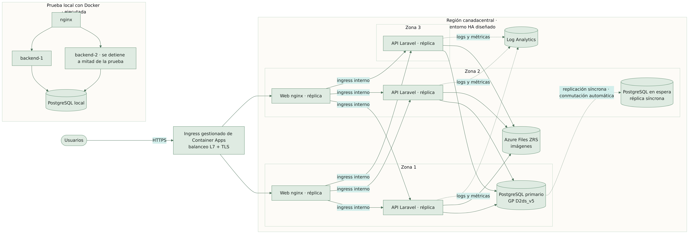

La matriz completa y los puntos únicos de fallo restantes están en [`docs/architecture/demo-vs-ha.md`](../architecture/demo-vs-ha.md). En síntesis: HA tolera la pérdida de una zona (réplicas en varias zonas y PostgreSQL ZoneRedundant), pero **no** la pérdida de una región; GHCR, las migraciones al arranque, la ausencia de WAF y la dependencia de PostgreSQL para sesiones son riesgos residuales declarados. La prueba local solo cubre la capa de API: la base de datos local sigue siendo única. No se afirma alta disponibilidad real en Azure.

## 25. Pruebas y resultados

| Ámbito | Herramienta | Resultado verificado |
|---|---|---|
Resultados del 12 de noviembre de 2026 (equipo local):

| Ámbito | Herramienta | Resultado verificado |
|---|---|---|
| Backend (productos, ofertas, stock, pedidos, transacciones, idempotencia, auth/autorización, errores, seguridad, seeders y migración de datos) | PHPUnit 11 | **70 pruebas / 415 aserciones OK** en PostgreSQL 16 y en SQLite |
| Lint backend | Pint | OK |
| Frontend (render, inicio, buscador con sugerencias, catálogo, filtros y ofertas, tarjetas, carrito, checkout, guardia admin, accesibilidad) | Vitest + Vue Test Utils + axe-core | **45 pruebas OK** |
| Tipos y lint frontend | vue-tsc, ESLint | OK |
| Build | Vite (dentro de la imagen Docker) | OK |
| E2E contra Docker, sin mocks | Playwright (Chromium) | **3 recorridos OK** (compra completa, administración, móvil), 22 capturas; axe en navegador: **0 violaciones** en 6 páginas; sin errores de CSP |
| Pedido en base de datos | `psql` | pedido del E2E guardado y movimiento de stock −2 registrado |
| Docker | Compose | build, arranque, health checks, red interna, persistencia: OK |
| Smoke test | `scripts/smoke-test.sh` | **18/18** |
| Concurrencia | `scripts/concurrency-check.mjs` | sin sobreventa (4 de 9, stock final 0) |
| Tolerancia a fallos local | `scripts/ha-local-test.sh` | 179/180 solicitudes OK con una réplica caída |
| Terraform | fmt / init -backend=false / validate | OK (demo y ha) |
| Workflows | actionlint + comprobación «sin despliegue automático» | OK |
| Scripts del día de la exposición | analizador de PowerShell 5.1 | sin errores de sintaxis; **no ejecutados** |
| Regresión clínica | `php artisan test` (sistema de enfermería) | **108/108**, sin modificar archivos |
| Dependencias | composer audit / npm audit | 0 vulnerabilidades conocidas (5-nov-2026; dependencias sin cambios desde entonces) |

En la primera versión, las pruebas E2E detectaron y se corrigieron dos problemas de accesibilidad y un defecto visual. En el rediseño, una primera ejecución de la prueba de alta disponibilidad mostró fallos que resultaron ser el límite de 120 solicitudes por minuto de la propia API, no la conmutación; el script se ajustó a un ritmo inferior al límite y ahora registra el código HTTP de cada fallo.

**Evidencias visuales** (capturas reales del sitio local; el índice completo está en `docs/evidence/README.md`):

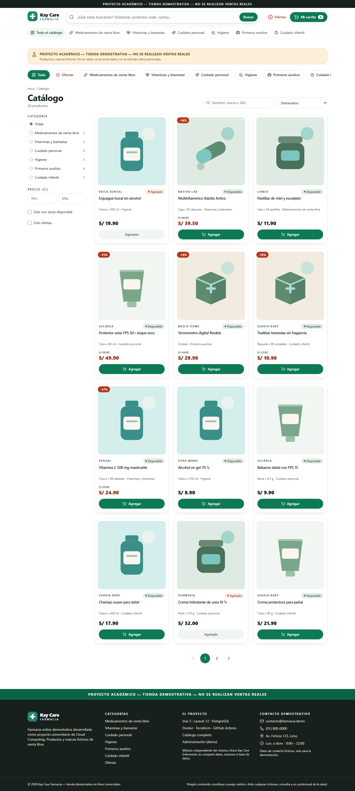

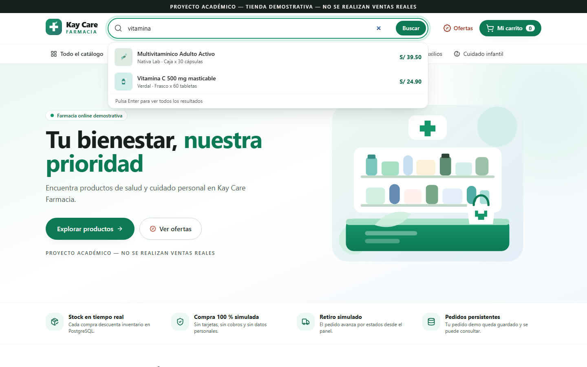

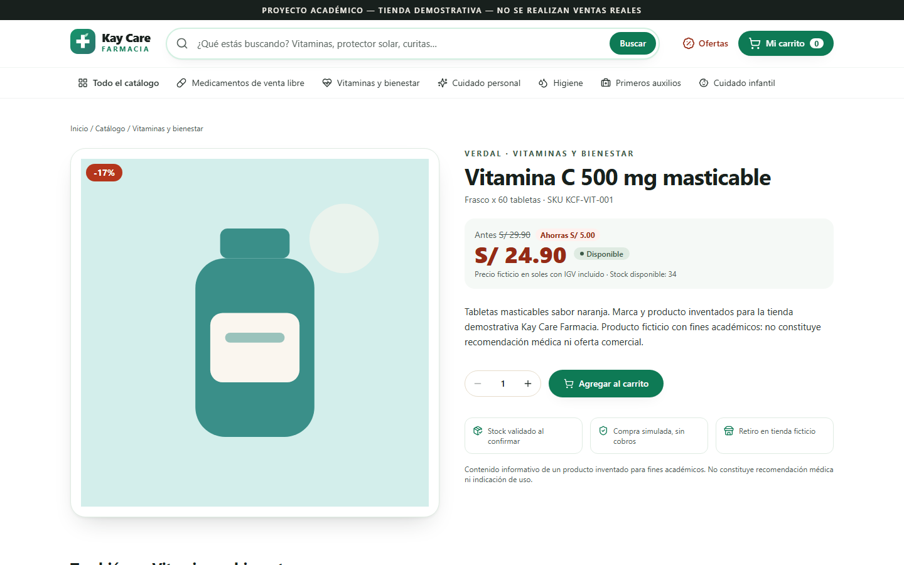

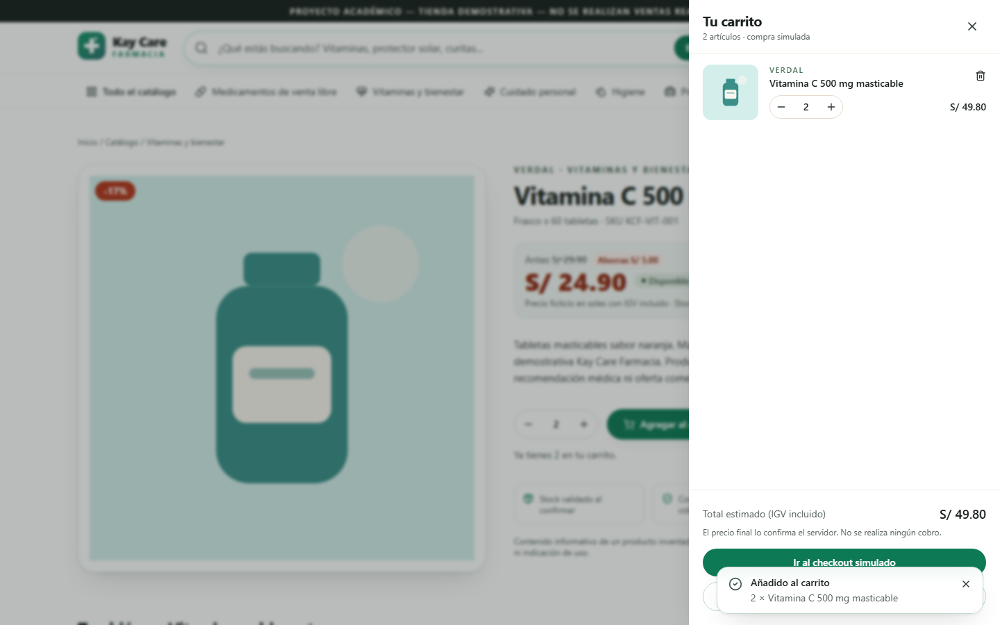

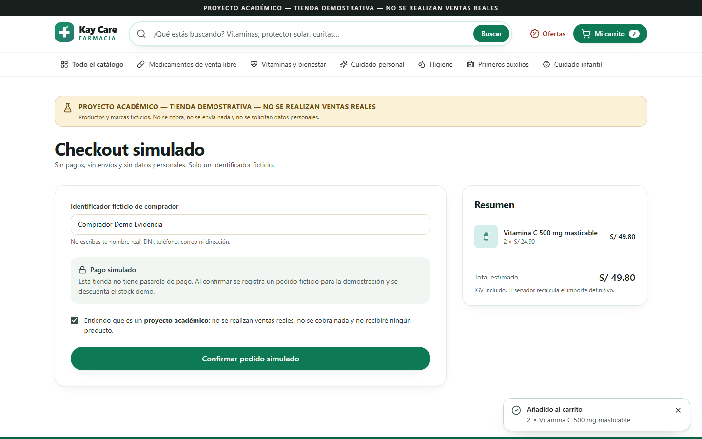

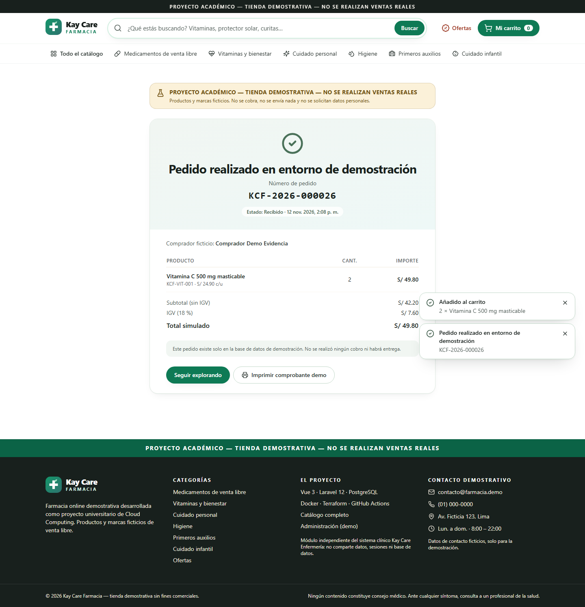

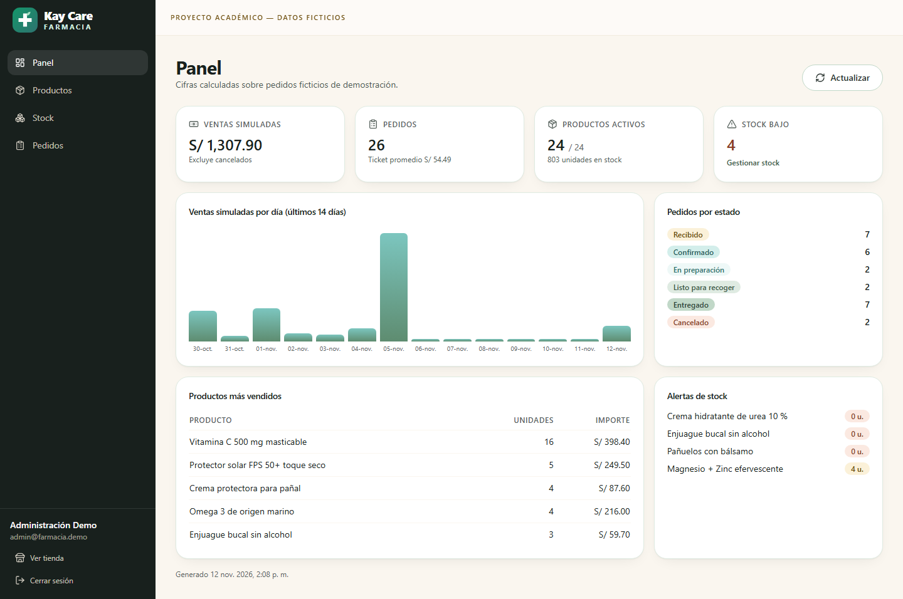

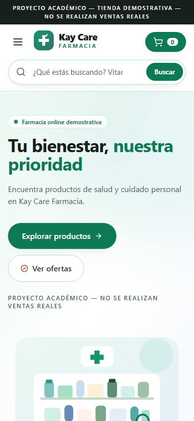

## 26. Estimación de costos y supuestos

Detalle en [`docs/report/costos.md`](costos.md). Los precios unitarios se obtuvieron de la API pública de precios minoristas de Azure para `canadacentral` (12-nov-2026), y `azure-preflight.ps1` los actualiza al ejecutarse.

**Consumo de créditos Azure para Kay Care Farmacia: US$ 0.** Se verificó en solo lectura que no existe ningún grupo de recursos ni recurso de la farmacia en la suscripción.

| Escenario | Costo estimado | Componente principal |
|---|---|---|
| DEMO el día de la exposición (8 h de vida, 4 h con tráfico) | ≈ US$ 0,60 | Container Apps activas y PostgreSQL B1ms |
| DEMO olvidado un mes | ≈ US$ 18–20 | PostgreSQL B1ms (cobra aunque no haya visitas) |
| HA (solo diseño) | ≈ US$ 650–700/mes | PostgreSQL GP D2ds_v5 con HA y réplicas mínimas de Container Apps |

No se asume gratuidad. La concesión gratuita de Container Apps de la suscripción ya la consumen otras aplicaciones, y las 750 h gratuitas de B1ms de Azure for Students no pudieron verificarse. **Recursos que cobran aunque no haya visitantes:** el cómputo y el almacenamiento de PostgreSQL, y la ingesta de logs. Container Apps no cobra mientras está escalado a cero. **No se creó ningún recurso ni se ejecutó `terraform apply`.**

## 27. Aislamiento respecto al sistema clínico

- Todo el código nuevo está en `academic-pharmacy/` y en `.github/workflows/pharmacy-*.yml`.
- Base de datos, usuario, cookie de sesión (`kcf_pharmacy_session`), `APP_KEY`, red y proyecto Compose (`kaycare-pharmacy`) propios.
- Los workflows nuevos solo se disparan con cambios en `academic-pharmacy/**`.
- `git diff 5276375..HEAD` fuera de `academic-pharmacy/` y de los dos workflows `pharmacy-*`: **vacío** (verificado de nuevo en la rama de finalización).
- La batería clínica (`php artisan test` en `backend/`) pasa **108/108** sin modificar ningún archivo.

## 28. Conclusiones y trabajo futuro

**Conclusiones.**
1. Es posible incorporar un módulo de e-commerce a un repositorio existente sin afectar el sistema principal, verificándolo con diff y con su batería de pruebas.
2. El bloqueo pesimista más la restricción de unicidad de la clave de idempotencia resuelve, de forma comprobable, la sobreventa y los pedidos duplicados.
3. Servir la SPA y la API desde el mismo origen simplifica la seguridad (CSRF, cookies, CORS) y permite que la API no sea pública.
4. La alta disponibilidad cuesta unas 35 veces más que dejar DEMO encendido un mes; la decisión debe basarse en el nivel de servicio requerido.
5. Con la infraestructura como código, preparar la nube no exige gastar en ella: el entorno se valida, se estima y se despliega el día necesario con una confirmación explícita, y se retira el mismo día.
6. Una interfaz inspirada en patrones conocidos del sector (buscador, categorías, ofertas) facilita la navegación sin copiar marcas, siempre que la identidad visual sea propia.

**Trabajo futuro.** Despliegue autorizado el día de la exposición; Key Vault con identidad gestionada; Azure Front Door con WAF; job dedicado de migraciones; Redis para sesiones y caché; multi-región activa-pasiva; pruebas de carga; MFA para el administrador.

## 29. Referencias y anexos

**Referencias.**
- Microsoft. *Azure Container Apps documentation* (redes, redundancia de zona, ingress, sondas). learn.microsoft.com/azure/container-apps
- Microsoft. *Azure Database for PostgreSQL – Flexible Server: high availability concepts.* learn.microsoft.com/azure/postgresql
- Microsoft. *Azure pricing calculator.* azure.microsoft.com/pricing/calculator
- Microsoft. *Azure Retail Prices REST API.* learn.microsoft.com/rest/api/cost-management/retail-prices/azure-retail-prices
- Microsoft. *Azure for Students* y *Azure Container Apps billing* (concesión gratuita mensual). learn.microsoft.com/azure/container-apps/billing
- W3C. *WAI-ARIA Authoring Practices — Combobox Pattern.* w3.org/WAI/ARIA/apg/patterns/combobox
- HashiCorp. *Terraform AzureRM Provider documentation.* registry.terraform.io/providers/hashicorp/azurerm
- GitHub. *Security hardening with OpenID Connect* y *Using environments for deployment.* docs.github.com
- Laravel. *Laravel 12.x documentation* (Sanctum, Rate Limiting, Validation). laravel.com/docs/12.x
- OWASP Foundation. *OWASP Top 10* y *Cheat Sheet Series* (CSRF, XSS, File Upload). owasp.org
- Vue.js. *Vue 3 documentation — Security.* vuejs.org/guide/best-practices/security
- PostgreSQL Global Development Group. *Explicit Locking — Row-Level Locks.* postgresql.org/docs/16

**Anexos (en el repositorio).**
- A. Diagramas fuente y exportados: `docs/diagrams/` (A flujo de compra, A2 detalle técnico, B arquitectura Azure, C CI/CD, D alta disponibilidad; se regeneran con `scripts/render-diagrams.sh`).
- B. Evidencia: `docs/evidence/` (22 capturas Playwright y `evidence-report.json`).
- C. Matriz de amenazas: `docs/security/threat-matrix.md`.
- D. Matriz DEMO vs HA: `docs/architecture/demo-vs-ha.md`.
- E. Costos: `docs/report/costos.md`.
- F. Guía de exposición (6–7 min): `docs/PRESENTACION.md`.
- G. Procedimiento del día de la exposición: `docs/deploy/DIA-EXPOSICION.md`.
- H. Enlace público: **[URL a completar el día de la exposición, solo tras verificar que responde]**. Ejecución local: http://localhost:8088.
