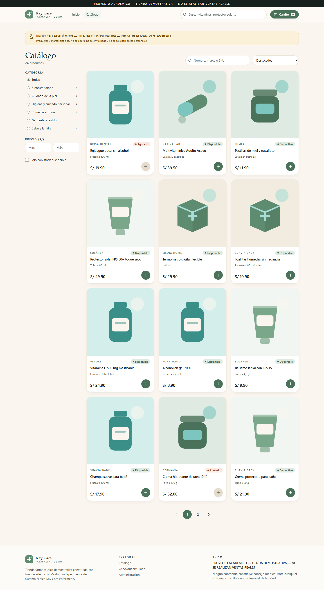
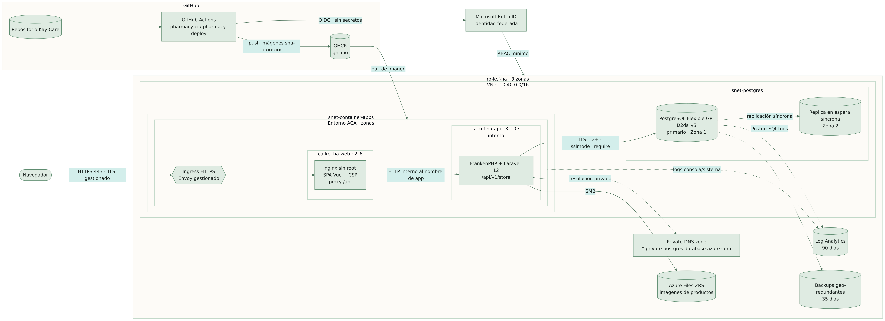
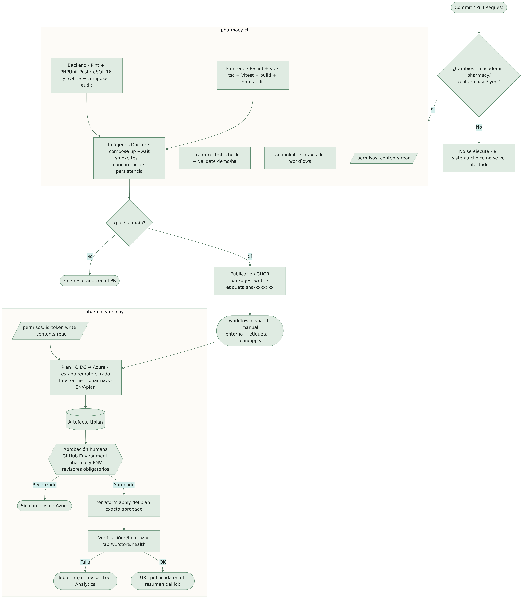

<!-- PORTADA EDITABLE: reemplace los campos entre corchetes. -->

<div class="portada">

**[NOMBRE DE LA UNIVERSIDAD]**
**[FACULTAD / ESCUELA PROFESIONAL]**

# Kay Care Farmacia: tienda e-commerce académica con arquitectura modular contenerizada, alta disponibilidad en Azure y despliegue continuo

**Curso:** [Nombre del curso]
**Docente:** [Nombre del docente]
**Integrantes:** [Apellidos y nombres — código]
**Ciclo / Sección:** [Ciclo] — [Sección]
**Lugar y fecha:** [Ciudad], noviembre de 2026

> PROYECTO ACADÉMICO — TIENDA DEMOSTRATIVA — NO SE REALIZAN VENTAS REALES

</div>

> **Nota sobre el título.** La solución se compone de dos servicios desplegables (frontend y API) y un backend organizado en módulos de dominio dentro de una sola aplicación Laravel. No es una arquitectura de microservicios; por ello el título habla de *arquitectura modular contenerizada*.

---

## Resumen

Se diseñó e implementó *Kay Care Farmacia*, una tienda farmacéutica demostrativa con productos ficticios de venta libre, sin pagos ni datos personales reales, desarrollada como módulo independiente dentro del repositorio Kay Care y aislada del sistema clínico de enfermería existente. La solución consta de una SPA en Vue 3 con TypeScript servida por nginx sin privilegios, una API REST en Laravel 12 y una base de datos PostgreSQL. El checkout se ejecuta en una única transacción con bloqueo pesimista de filas, precios calculados en el servidor y claves de idempotencia. La infraestructura se describe con Terraform en dos entornos de Azure —DEMO de bajo costo y HA con redundancia de zona— y se automatiza con GitHub Actions mediante OIDC y aprobación manual. Se verificaron 65 pruebas de backend sobre PostgreSQL 16, 37 pruebas de frontend, 3 recorridos E2E con Playwright, una prueba de concurrencia sin sobreventa, la persistencia del volumen y la validación de ambos entornos Terraform. No se desplegó en Azure: la URL pública queda *pendiente de despliegue*.

**Palabras clave:** comercio electrónico, contenedores, Azure Container Apps, PostgreSQL, Terraform, CI/CD, idempotencia, alta disponibilidad.

## Abstract

*Kay Care Farmacia* is an academic, fictitious over-the-counter pharmacy store built as an isolated module of the Kay Care repository. It combines a Vue 3 + TypeScript SPA behind an unprivileged nginx, a Laravel 12 REST API and PostgreSQL. Checkout runs in a single database transaction with row-level locks, server-side pricing and idempotency keys. Infrastructure is defined with Terraform for two Azure environments (low-cost DEMO and zone-redundant HA) and delivered through GitHub Actions with OIDC and manual approval. All automated tests, a concurrency test, volume persistence and Terraform validation were verified locally; no Azure deployment was performed.

---

## 1. Introducción

El comercio electrónico de productos de cuidado personal exige consistencia de inventario, seguridad y disponibilidad. Este proyecto construye una tienda demostrativa que permite estudiar esos requisitos de extremo a extremo —desde la interfaz hasta la nube— sin riesgos legales ni éticos: todos los productos y marcas son inventados, no existe pasarela de pago y no se solicitan datos personales.

## 2. Planteamiento del problema

El repositorio Kay Care ya contiene un sistema clínico de enfermería en producción académica. Se requiere añadir un módulo de e-commerce **sin alterar** ese sistema, sin compartir base de datos, sesiones ni credenciales, y demostrar prácticas de ingeniería de nube: contenedores, infraestructura como código, CI/CD y alta disponibilidad, con costos controlados.

## 3. Justificación

- **Académica:** integra contenidos de desarrollo web, bases de datos transaccionales, seguridad, DevOps y arquitectura de nube en un caso realista.
- **Técnica:** problemas como la sobreventa o los pedidos duplicados por reintentos son frecuentes en tiendas reales y se resuelven aquí con mecanismos verificables.
- **Económica:** el diseño DEMO puede operar por decenas de dólares al mes y apagarse cuando no se usa.

## 4. Objetivos

**General.** Desarrollar y documentar una tienda e-commerce académica, segura y reproducible, preparada para desplegarse en Azure en dos niveles de disponibilidad.

**Específicos.**
1. Implementar catálogo con búsqueda, filtros, ordenamiento y stock; carrito; checkout simulado y confirmación.
2. Garantizar consistencia del inventario mediante transacciones, bloqueo e idempotencia.
3. Implementar un panel de administración autenticado con CRUD, stock y pedidos.
4. Contenerizar la solución con imágenes sin root y health checks.
5. Definir la infraestructura en Terraform para los entornos DEMO y HA.
6. Automatizar integración y despliegue con permisos mínimos y aprobación humana.
7. Verificar con pruebas automatizadas y documentar riesgos, costos y puntos únicos de fallo.

## 5. Alcance y limitaciones

**Incluye:** las páginas públicas y de administración, la API `/api/v1/store`, Docker Compose, Terraform (módulos y dos entornos), dos workflows y la documentación.

**No incluye:** pagos reales, envíos, cuentas de compradores, facturación electrónica ni un despliegue real en Azure (requiere autorización del propietario de la suscripción). La disponibilidad del entorno HA es la que ofrece el diseño; **no se midió**.

## 6. Marco teórico

- **Arquitectura modular:** separación por módulos de dominio (catálogo, checkout, inventario, pedidos, administración) dentro de una aplicación desplegable, con contratos claros entre capas.
- **Transacciones ACID y bloqueo pesimista:** `SELECT … FOR UPDATE` serializa el acceso a las filas de producto durante el checkout.
- **Idempotencia:** una operación repetida con la misma clave produce el mismo resultado sin efectos adicionales (patrón usado por pasarelas de pago).
- **Contenedores y orquestación serverless:** Azure Container Apps ejecuta contenedores con escalado automático (incluso a cero) sobre un entorno gestionado.
- **Infraestructura como código:** Terraform describe recursos de forma declarativa, versionable y revisable.
- **Alta disponibilidad por zonas:** distribuir réplicas y bases de datos en zonas de disponibilidad independientes dentro de una región.
- **CI/CD con OIDC:** GitHub Actions obtiene credenciales temporales de Microsoft Entra ID mediante federación, sin secretos de larga duración.

## 7. Requisitos funcionales

| ID | Requisito |
|---|---|
| RF-01 | Mostrar inicio con productos destacados y categorías. |
| RF-02 | Catálogo con búsqueda por nombre/marca/SKU, filtros por categoría, precio y disponibilidad, ordenamiento y paginación. |
| RF-03 | Detalle de producto con stock y productos relacionados. |
| RF-04 | Carrito en panel lateral con cantidades y validación de stock contra el servidor. |
| RF-05 | Checkout simulado con identificador ficticio, sin DNI, dirección ni datos bancarios. |
| RF-06 | Confirmación con número de pedido. |
| RF-07 | Login de administrador sin registro público. |
| RF-08 | Dashboard con indicadores calculados sobre datos demo. |
| RF-09 | CRUD de productos con validación de imágenes. |
| RF-10 | Gestión de stock auditada. |
| RF-11 | Gestión de pedidos con máquina de estados. |
| RF-12 | Aviso «PROYECTO ACADÉMICO — TIENDA DEMOSTRATIVA — NO SE REALIZAN VENTAS REALES» en catálogo, checkout y confirmación. |

## 8. Requisitos no funcionales

| ID | Requisito | Cómo se cumple |
|---|---|---|
| RNF-01 Seguridad | OWASP básico | Sección 18 y matriz de amenazas |
| RNF-02 Consistencia | Sin sobreventa ni duplicados | Sección 17 |
| RNF-03 Disponibilidad | Tolerar la caída de una zona (HA) | Sección 24 |
| RNF-04 Accesibilidad | Navegación por teclado, contraste, etiquetas | axe sin violaciones (sección 25) |
| RNF-05 Rendimiento percibido | Skeletons, animaciones transform/opacity, `prefers-reduced-motion` | Frontend |
| RNF-06 Portabilidad | `docker compose up --build` | Sección 20 |
| RNF-07 Costo | DEMO ≤ US$ 30/mes estimado | Sección 26 |
| RNF-08 Aislamiento | Nada compartido con el sistema clínico | Sección 27 |

## 9. Metodología de trabajo

Desarrollo iterativo con control de versiones en Git: rama `feat/academic-pharmacy-cloud` creada desde `main` en un *worktree* separado, commits por incremento (backend → frontend → contenedores → infraestructura → CI/CD → documentación) y verificación automatizada al cierre de cada incremento. La coordinación con otros agentes que trabajan en el repositorio se realizó reservando exclusivamente la ruta `academic-pharmacy/` y los workflows `pharmacy-*`.

## 10. Arquitectura de la solución

| Capa | Tecnología | Responsabilidad |
|---|---|---|
| Presentación | Vue 3, TypeScript, Vite, Tailwind, Vue Router, Pinia, Lucide | SPA pública y panel |
| Borde | nginx-unprivileged 1.27 | Archivos estáticos, CSP y cabeceras, proxy de `/api` (mismo origen) |
| Aplicación | Laravel 12 sobre FrankenPHP (PHP 8.3) | API REST, Form Requests, servicios de dominio |
| Datos | PostgreSQL 16 | Catálogo, pedidos, movimientos, sesiones y caché |
| Archivos | Volumen Docker / Azure Files | Imágenes subidas por el administrador |

**Módulos de dominio del backend:** `Catalog\ProductSearch`, `Checkout\CartPricer`, `Checkout\CheckoutService`, `Inventory\StockService`, `Orders\OrderStatusService`, `Admin\DashboardService`.

El navegador habla con **un solo origen**: nginx sirve la SPA y reenvía `/api` a la API interna. Así la cookie de sesión es de primera parte, el CSRF de Sanctum funciona sin CORS permisivo y la API no se expone a Internet.

## 11. Diseño de la base de datos

| Tabla | Propósito | Restricciones relevantes |
|---|---|---|
| `admin_users` | Única identidad autenticable | email único, contraseña bcrypt |
| `categories` | Categorías | slug único |
| `products` | Productos ficticios | SKU y slug únicos; `CHECK stock >= 0`; `CHECK price_cents > 0`; precios en céntimos (entero) |
| `orders` | Pedidos simulados | número único, `idempotency_key` **única**, `request_hash`, `lookup_token`, `CHECK status IN (…)` |
| `order_items` | Líneas con instantánea de nombre/SKU/precio | `CHECK quantity > 0` |
| `order_status_history` | Auditoría de estados | administrador y nota |
| `stock_movements` | Auditoría de inventario | delta, stock resultante, motivo, referencia |
| `sessions`, `cache`, `cache_locks`, `jobs` | Infraestructura Laravel | — |

Los importes se guardan como enteros en céntimos de sol para evitar errores de redondeo de coma flotante. El IGV (18 %) está incluido en el precio de lista y se desglosa como `round(total × 18 / 118)`.

## 12. Diseño de la API REST

Prefijo `/api/v1/store`. Errores uniformes `{ message, code, details | errors }`.

| Método | Ruta | Descripción | Protección |
|---|---|---|---|
| GET | `/health` | Salud (incluye BD) | — |
| GET | `/categories`, `/products`, `/products/{slug}`, `/products/{slug}/related` | Catálogo | 120/min |
| POST | `/cart/validate` | Precios y stock actuales | 120/min, CSRF |
| POST | `/checkout` | Pedido simulado | `Idempotency-Key`, 10/min, CSRF |
| GET | `/orders/{número}?token=` | Confirmación | token opaco |
| GET | `/sanctum/csrf-cookie` | Cookie CSRF | — |
| POST | `/admin/login`, `/admin/logout`; GET `/admin/me` | Sesión | 5/min login |
| GET | `/admin/dashboard` | Indicadores | sesión |
| GET/POST/PUT/DELETE | `/admin/products[/{id}]`, POST `/image`, POST `/stock` | Productos y stock | sesión |
| GET | `/admin/stock-movements` | Auditoría | sesión |
| GET/PATCH | `/admin/orders[/{id}][/status]` | Pedidos | sesión |

Códigos de dominio: `insufficient_stock` (409), `product_unavailable` (422), `idempotency_conflict` (409), `invalid_status_transition` (422), `negative_stock` (422), `product_has_orders` (409), `too_many_requests` (429), `csrf_token_mismatch` (419).

## 13. Diseño de la interfaz (UI/UX)

Estilo premium minimalista: blanco cálido (`#FAF6EF`), verde salvia (`#5E8C70`) y turquesa suave (`#7CC6BF`); ilustraciones vectoriales propias en lugar de fotos de marcas reales. Animaciones solo con `transform`/`opacity` y desactivadas con `prefers-reduced-motion`; *skeleton loaders* durante las cargas; *toasts* accesibles (`aria-live`). Todos los botones ejecutan una acción real. El panel lateral del carrito atrapa el foco, se cierra con Escape y devuelve el foco al disparador.



## 14. Flujo del programa (diagrama A)

El diagrama muestra el recorrido del comprador y del administrador con sus decisiones y errores (validación, stock, idempotencia, rate limit, fallo de red y reintento).


## 15. Implementación del backend

- **Form Requests** validan toda entrada: filtros del catálogo (lista blanca de ordenamientos, rangos de precio), carrito (1–10 unidades, ≤ 20 líneas), checkout (alias ficticio, cabecera `Idempotency-Key`, aceptación del aviso), productos, imágenes, stock y estados.
- **Servicios de dominio** encapsulan la lógica; los controladores solo orquestan.
- **Autenticación** por sesión con un guard `admin` propio y Sanctum en modo SPA; middleware `EnsureAdmin` como defensa adicional.
- **Seeders** idempotentes: 6 categorías, 24 productos ficticios y 18 pedidos creados a través del mismo servicio de checkout (stock e historial coherentes).
- **Observabilidad:** logs a `stderr`, `X-Request-Id` en cada respuesta y en el contexto de log.

## 16. Implementación del frontend

- Router con carga diferida por vista y guardia para `/admin` (redirección al login con retorno seguro, sin *open redirect*).
- Stores de Pinia: carrito (persistido en `localStorage` con validación de datos corruptos), toasts y sesión.
- Cliente HTTP con manejo de CSRF (reintento único ante 419) y errores normalizados.
- El checkout reutiliza la misma clave de idempotencia mientras el contenido del carrito no cambie, de modo que un reintento tras un fallo de red no duplica el pedido.

## 17. Transacciones, concurrencia e idempotencia

1. Se normaliza el carrito (líneas fusionadas, ordenadas por id) y se calcula un hash SHA-256 del contenido.
2. Si la clave ya existe: mismo hash → se devuelve el mismo pedido (200, `Idempotency-Replayed: true`); hash distinto → 409.
3. En una transacción: `SELECT … FOR UPDATE` de los productos en orden ascendente (evita interbloqueos), verificación de stock y estado, cálculo de precios desde la fila bloqueada, inserción del pedido y sus líneas, descuento de stock y registro de movimientos.
4. Si dos peticiones simultáneas usan la misma clave, la restricción `UNIQUE` hace fallar a una; el servicio captura la violación y devuelve el pedido ganador.

**Verificación real (PostgreSQL 16 en Docker):** 7 compras simultáneas de 1 unidad sobre un producto con stock 2 → **2 pedidos creados, 5 rechazados con 409, stock final 0** (`scripts/concurrency-check.mjs`).

## 18. Seguridad

HTTPS (ingress de Azure con certificado gestionado; HSTS cuando el tráfico llega por HTTPS), validación de entradas, protección XSS (escape de Vue, CSP `script-src 'self'`, prohibición de `v-html`), CSRF (Sanctum), inyección SQL (consultas parametrizadas y escape de comodines), contraseñas con bcrypt, rate limiting por ruta, CORS con lista blanca, cabeceras de seguridad en nginx y en la API, `APP_DEBUG=false` forzado en producción, secretos fuera de Git (generados por Terraform, OIDC en CI/CD) y contenedores sin root con sistema de archivos de solo lectura.

## 19. Matriz de amenazas y controles

La matriz completa (22 amenazas STRIDE con controles, evidencia, probabilidad e impacto residual) está en [`docs/security/threat-matrix.md`](../security/threat-matrix.md). Riesgos aceptados: sin WAF, secretos en Container Apps en lugar de Key Vault, sin MFA para el administrador demo y PostgreSQL público en DEMO.

## 20. Contenerización (Docker)

| Imagen | Base | Usuario | Health check |
|---|---|---|---|
| API | `composer:2.8` → `dunglas/frankenphp:1-php8.3-alpine` | `app` (UID 10001), sin `setcap` | `GET /api/v1/store/health` |
| Frontend | `node:20.18-alpine` → `nginxinc/nginx-unprivileged:1.27-alpine` | `nginx` (UID 101) | `GET /healthz` |

`docker-compose.yml` define tres servicios (db, backend, frontend), una red `data` **interna** (PostgreSQL sin salida ni puerto publicado), un volumen persistente `pharmacy_pgdata`, `read_only`, `cap_drop: ALL` y `no-new-privileges`. El entrypoint exige `APP_KEY`, rechaza `APP_DEBUG=true` en producción, espera a la base de datos, aplica migraciones (con bloqueo cuando ya existe el esquema) y carga datos demo idempotentes.

**Verificado:** arranque con health checks en verde; prueba de humo 18/18; persistencia tras `docker compose down`/`up` (21 pedidos antes y después); frontend sin acceso a la base de datos; procesos con UID 10001 y 101.

## 21. Infraestructura como código (Terraform)

```
infra/terraform/
├── modules/ monitoring · network · postgres · container-environment · container-app
└── environments/
    ├── demo/  providers.tf versions.tf variables.tf main.tf outputs.tf terraform.tfvars.example
    └── ha/    (misma estructura)
```

Proveedores `azurerm ~> 4.14` (validado con 4.81.0) y `random ~> 3.6`. Las contraseñas y la `APP_KEY` se generan con `random_password`/`random_bytes` y se entregan como secretos de Container Apps. El estado remoto se configura con un backend `azurerm` cifrado (plantilla incluida). **Resultado:** `terraform fmt -check` sin cambios y `terraform validate` exitoso en ambos entornos.

**Registro elegido: GHCR.** Justificación: integración nativa con GitHub Actions (`GITHUB_TOKEN` sin secretos adicionales), sin costo para paquetes públicos y sin un recurso facturable adicional en Azure (ACR Basic cuesta ≈ US$ 5/mes). Contrapartida: dependencia de un servicio externo a Azure; para producción se recomendaría ACR Premium con geo-replicación e identidad gestionada.

## 22. Arquitectura en Azure (diagrama B)



En HA, el entorno de Container Apps se integra en una subred delegada con redundancia de zona; la API solo tiene ingress interno; PostgreSQL vive en una subred delegada con zona DNS privada y réplica en espera síncrona en otra zona; las imágenes se guardan en Azure Files ZRS y los logs en Log Analytics. DEMO usa el mismo diseño lógico sin VNet, sin redundancia de zona y con PostgreSQL Burstable público (TLS obligatorio).

## 23. CI/CD (diagrama C)



- **`pharmacy-ci.yml`** (permiso `contents: read`, `packages: write` solo en el job de imágenes): Pint + PHPUnit sobre PostgreSQL y SQLite, auditorías de dependencias, ESLint + vue-tsc + Vitest + build, `terraform fmt`/`validate` por entorno, actionlint, construcción de imágenes, `docker compose up --wait`, smoke test, prueba de concurrencia y de persistencia; publicación en GHCR solo en `main`.
- **`pharmacy-deploy.yml`** (`id-token: write`, `contents: read`): manual, OIDC, `plan` guardado como artefacto, `apply` del plan exacto tras aprobación en el GitHub Environment `pharmacy-<entorno>` y verificación posterior.

Estado: la sintaxis de ambos workflows se validó con actionlint 1.7.4. **Aún no se han ejecutado en GitHub** (requieren push de la rama y configuración de Environments/variables OIDC).

## 24. Alta disponibilidad: DEMO vs HA

La matriz completa y los puntos únicos de fallo restantes están en [`docs/architecture/demo-vs-ha.md`](../architecture/demo-vs-ha.md). En síntesis: HA tolera la pérdida de una zona (réplicas en varias zonas y PostgreSQL ZoneRedundant), pero **no** la pérdida de una región; GHCR, las migraciones al arranque, la ausencia de WAF y la dependencia de PostgreSQL para sesiones son riesgos residuales declarados.

## 25. Pruebas y resultados

| Ámbito | Herramienta | Resultado verificado |
|---|---|---|
| Backend (productos, stock, pedidos, transacciones, idempotencia, auth/autorización, errores, seguridad, seeders) | PHPUnit 11 | **65 pruebas / 393 aserciones OK** en PostgreSQL 16 y en SQLite |
| Lint backend | Pint | OK |
| Frontend (render, catálogo, filtros, búsqueda, carrito, checkout, confirmación, guardia admin, accesibilidad) | Vitest + Vue Test Utils + axe-core | **37 pruebas OK** |
| Tipos y lint frontend | vue-tsc, ESLint | OK |
| Build | Vite | OK |
| E2E y evidencia | Playwright (Chromium) | **3 recorridos OK**, 18 capturas; axe en navegador: **0 violaciones** en 6 páginas; sin errores de CSP |
| Docker | Compose | build, arranque, health checks, red interna, persistencia: OK |
| Smoke test | `scripts/smoke-test.sh` | **18/18** |
| Concurrencia | `scripts/concurrency-check.mjs` | sin sobreventa (2 de 7) |
| Terraform | fmt / validate | OK (demo y ha) |
| Workflows | actionlint | OK |
| Regresión clínica | `php artisan test` (sistema de enfermería) | **108/108** en `main` y **106/106** en `feat/claude-backend`, sin modificar archivos |
| Dependencias | composer audit / npm audit | 0 vulnerabilidades conocidas |

Durante las pruebas E2E se detectaron y corrigieron dos problemas de accesibilidad (contraste insuficiente de dos tonos y nombres accesibles que no coincidían con el texto visible) y un defecto visual (barras del gráfico del panel sin altura).

## 26. Estimación de costos y supuestos

Detalle en [`docs/report/costos.md`](costos.md). Resumen (estimación de lista, sin verificar en la calculadora oficial en esta fecha):

| Entorno | Costo mensual estimado | Principal componente |
|---|---|---|
| DEMO | ≈ US$ 17–25 | PostgreSQL B1ms |
| HA | ≈ US$ 650–700 | PostgreSQL GP D2ds_v5 con HA (≈ 40 %) y réplicas mínimas de Container Apps (≈ 45 %) |

Supuestos: región East US 2, 730 h/mes, tráfico académico bajo, imágenes públicas en GHCR, réplicas mínimas de HA siempre activas (peor caso). **No se creó ningún recurso ni se ejecutó `terraform apply`.**

## 27. Aislamiento respecto al sistema clínico

- Todo el código nuevo está en `academic-pharmacy/` y en `.github/workflows/pharmacy-*.yml`.
- Base de datos, usuario, cookie de sesión (`kcf_pharmacy_session`), `APP_KEY`, red y proyecto Compose (`kaycare-pharmacy`) propios.
- Los workflows nuevos solo se disparan con cambios en `academic-pharmacy/**`.
- `git diff 5276375..HEAD` fuera de `academic-pharmacy/` y de los dos workflows nuevos: **vacío**.

## 28. Conclusiones y trabajo futuro

**Conclusiones.**
1. Es posible incorporar un módulo de e-commerce a un repositorio existente sin afectar el sistema principal, verificándolo con diff y con su batería de pruebas.
2. El bloqueo pesimista más la restricción de unicidad de la clave de idempotencia resuelve, de forma comprobable, la sobreventa y los pedidos duplicados.
3. Servir la SPA y la API desde el mismo origen simplifica la seguridad (CSRF, cookies, CORS) y permite que la API no sea pública.
4. La alta disponibilidad tiene un costo aproximadamente 30 veces mayor que el entorno DEMO; la decisión debe basarse en el nivel de servicio requerido.

**Trabajo futuro.** Despliegue real con autorización; Key Vault con identidad gestionada; Azure Front Door con WAF; job dedicado de migraciones; Redis para sesiones y caché; multi-región activa-pasiva; pruebas de carga; MFA para el administrador.

## 29. Referencias y anexos

**Referencias.**
- Microsoft. *Azure Container Apps documentation* (redes, redundancia de zona, ingress, sondas). learn.microsoft.com/azure/container-apps
- Microsoft. *Azure Database for PostgreSQL – Flexible Server: high availability concepts.* learn.microsoft.com/azure/postgresql
- Microsoft. *Azure pricing calculator.* azure.microsoft.com/pricing/calculator
- HashiCorp. *Terraform AzureRM Provider documentation.* registry.terraform.io/providers/hashicorp/azurerm
- GitHub. *Security hardening with OpenID Connect* y *Using environments for deployment.* docs.github.com
- Laravel. *Laravel 12.x documentation* (Sanctum, Rate Limiting, Validation). laravel.com/docs/12.x
- OWASP Foundation. *OWASP Top 10* y *Cheat Sheet Series* (CSRF, XSS, File Upload). owasp.org
- Vue.js. *Vue 3 documentation — Security.* vuejs.org/guide/best-practices/security
- PostgreSQL Global Development Group. *Explicit Locking — Row-Level Locks.* postgresql.org/docs/16

**Anexos (en el repositorio).**
- A. Diagramas fuente y exportados: `docs/diagrams/` (regenerar con `scripts/render-diagrams.sh`).
- B. Evidencia: `docs/evidence/` (capturas Playwright y `evidence-report.json`).
- C. Matriz de amenazas: `docs/security/threat-matrix.md`.
- D. Matriz DEMO vs HA: `docs/architecture/demo-vs-ha.md`.
- E. Costos: `docs/report/costos.md`.
- F. Guion de presentación: `docs/PRESENTACION.md`.
- G. Enlace público: **URL pendiente de despliegue.**
